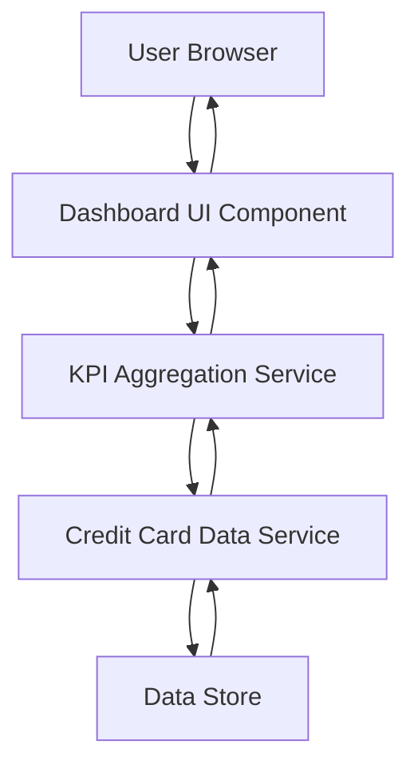

#### 1. High-Level Design

- **Summary:** This epic delivers a consolidated dashboard that displays key performance indicators (KPIs) for the user's credit card portfolio. The core requirement is to provide real-time visibility into critical financial metrics including monthly spend, total credit limit, available credit, and outstanding amounts across all credit cards through a responsive, modern interface.

- **Component Flow:**

- **Integration Points:** 
  - **Upstream:** Credit card data source or mock data service for retrieving card details, balances, credit limits, and outstanding amounts
  - **Downstream:** Responsive UI framework for rendering dashboard across multiple device types (desktop, tablet, mobile)

- **Key Assumptions:** 
  - KPI data is refreshed in near real-time (assumed refresh interval: 30-60 seconds or on-demand)
  - Credit card data service provides aggregated portfolio data via RESTful API endpoints

- **NFR Highlights:** Dashboard must be responsive across desktop, tablet, and mobile devices; Page load time must support real-time KPI updates; UI must handle display of multiple credit cards without performance degradation

- **Data Flow:** User accesses the dashboard through their browser. The Dashboard UI Component requests KPI data from the KPI Aggregation Service, which queries the Credit Card Data Service. The Data Service retrieves current card details, balances, limits, and outstanding amounts from the Data Store. Aggregated metrics (total spend, total limit, available credit, outstanding balance) are calculated and returned to the UI for display. The UI renders responsive visualizations of these KPIs optimized for the user's device.

#### 2. Validation Report

- **Requirements Coverage:** The design fully covers the epic's stated scope including monthly spend display, total credit limit calculation, available credit tracking, outstanding amount monitoring, responsive dashboard layout, and multi-card consolidated view. The component architecture supports all NFRs related to responsiveness, real-time updates, and multi-card performance. Integration dependencies with credit card data sources are explicitly addressed through the Credit Card Data Service component.