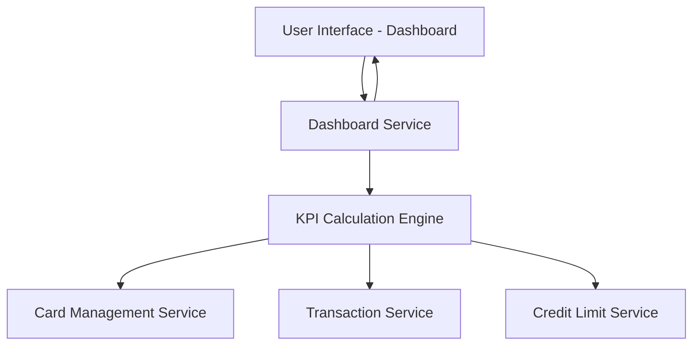

#### 1. High-Level Design

- **Summary:** This epic delivers a consolidated dashboard interface that provides users with a unified view of their entire credit card portfolio. Users can monitor key financial metrics (monthly spend, total credit limit, available credit, outstanding amounts) across all cards through KPI widgets and visualizations. The dashboard is designed to be modern, responsive, and accessible across desktop, tablet, and mobile devices, enabling informed financial decision-making.

- **Component Flow:**

- **Integration Points:**
  - **Upstream:** Card Management Service (retrieves card details), Transaction Service (calculates monthly spend and outstanding amounts), Credit Limit Service (calculates credit availability)
  - **Downstream:** None explicitly mentioned; serves as primary user-facing interface

- **Key Assumptions:** 
  - KPI calculations (monthly spend, available credit, outstanding amounts) are computed in real-time or near-real-time with caching to meet the 2-second load time requirement.
  - Card data, transaction data, and credit limit data are synchronized and consistent across all backend services.

- **NFR Highlights:** Must support responsive design across desktop, tablet, and mobile devices; dashboard load time must be under 2 seconds; UI must be accessible and comply with WCAG 2.1 standards; must handle real-time data refresh for KPI updates.

- **Data Flow:** User accesses dashboard → Dashboard Service requests data from KPI Calculation Engine → Engine retrieves card details from Card Management Service, transaction data from Transaction Service, and credit limits from Credit Limit Service → Engine calculates aggregated metrics (total credit limit, available credit, monthly spend, outstanding amounts) → Calculated KPIs are returned to Dashboard Service → Dashboard UI renders KPI widgets and card portfolio view with responsive layout → Real-time updates are pushed to UI as transaction or credit data changes.

#### 2. Validation Report

- **Requirements Coverage:** The design fully addresses the epic's scope including dashboard interface implementation, multiple credit card display and management, monthly spend calculation, total credit limit aggregation, available credit calculation, outstanding amount tracking, responsive layout, and KPI widgets/visualization. All NFRs are addressed: responsive design (client-side responsive framework), sub-2-second load time (KPI caching and efficient aggregation), WCAG 2.1 accessibility compliance (UI design standards), and real-time data refresh (event-driven updates or polling). All dependencies are incorporated: Card Management Service, Transaction Service, and Credit Limit Service integrations are clearly defined in the component flow.