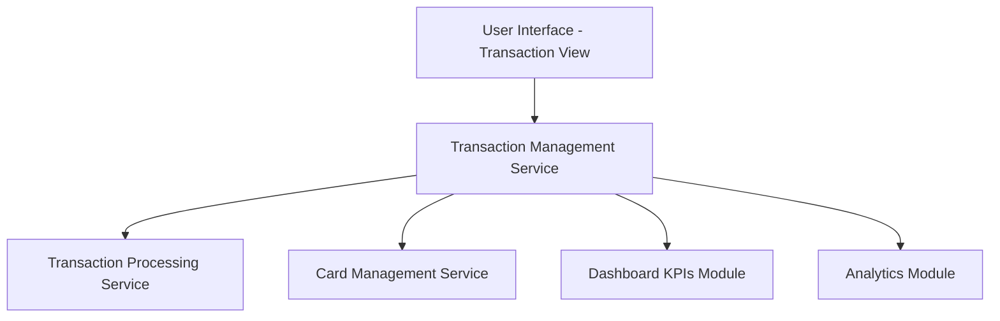

#### 1. High-Level Design

- **Summary:** This epic provides a comprehensive transaction viewing and monitoring capability that allows users to view, filter, and sort all credit card transactions across multiple cards. It serves as the data foundation for dashboard KPIs and analytics, displaying transaction details in a user-friendly format with filtering and sorting capabilities to help users track spending activity and patterns.

- **Component Flow:**

- **Integration Points:**
  - **Upstream:** Transaction Processing Service (provides transaction data), Card Management Service (associates transactions with cards)
  - **Downstream:** Dashboard KPIs module (feeds transaction data for metrics), Analytics module (feeds transaction data for insights)

- **Key Assumptions:** 
  - Transaction data is stored in a queryable format with indexed fields for efficient filtering and sorting by date, amount, category, and card.
  - Transaction history is retained for a defined period (e.g., 12-24 months) to support historical access requirements.

- **NFR Highlights:** Transaction history retrieval must respond in under 1 second; transaction data must be accurate and consistent with card statements; must support concurrent queries from multiple users; data integrity must be maintained across all operations.

- **Data Flow:** User accesses transaction view → Transaction Management Service queries Transaction Processing Service for transaction records → Service retrieves card associations from Card Management Service → Transactions are filtered and sorted based on user criteria (date range, card, amount) → Formatted transaction list is returned to UI → User can view transaction details → Transaction data is also pushed to Dashboard KPIs and Analytics modules for metric calculations and pattern analysis.

#### 2. Validation Report

- **Requirements Coverage:** The design comprehensively addresses the epic's scope including transaction list display, transaction details viewing, multi-card aggregation, data retrieval and processing, filtering and sorting capabilities, and transaction history access. The architecture meets all NFRs: sub-1-second response time (via indexed queries and efficient data retrieval), data accuracy and consistency (direct integration with Transaction Processing Service), concurrent user support (scalable service architecture), and data integrity (transactional operations). All dependencies are incorporated: Transaction Processing Service for data, Card Management Service for card associations, and data feeds to Dashboard KPIs and Analytics modules.