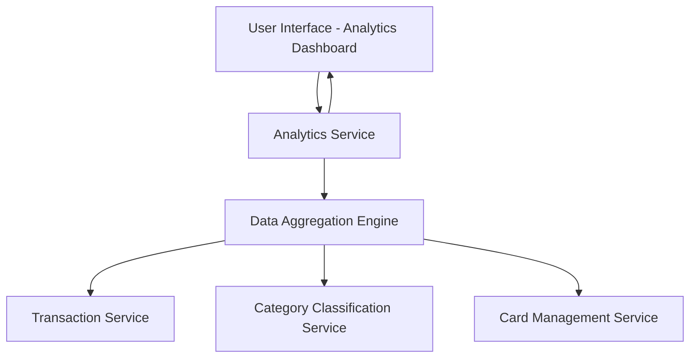

#### 1. High-Level Design

- **Summary:** This epic delivers an interactive analytics and visualization module that enables users to understand their credit card spending patterns through category-wise breakdowns (Food & Dining, Fuel, Shopping, Travel, Entertainment, Utilities, Healthcare, Education, Miscellaneous), monthly spend trends, and card-wise analysis. The system aggregates transaction data, classifies it into categories, and presents insights through responsive, interactive charts and graphs.

- **Component Flow:**

- **Integration Points:**
  - **Upstream:** Transaction Service (provides spending data), Category Classification Service (categorizes transactions), Card Management Service (provides card-wise data)
  - **Downstream:** Dashboard KPIs module (receives monthly spend metrics)

- **Key Assumptions:** 
  - Transaction categorization is performed by the Category Classification Service using predefined rules or ML models; category assignments are already available in transaction data.
  - Analytics calculations are performed on-demand with caching for frequently accessed data to meet the 3-second load time requirement.

- **NFR Highlights:** Analytics visualizations must load within 3 seconds; must support interactive filtering and drill-down; charts must be responsive across all device sizes; must handle large transaction datasets efficiently; real-time data accuracy required.

- **Data Flow:** User requests analytics view → Analytics Service retrieves transaction data from Transaction Service → Data Aggregation Engine processes and groups transactions by category, month, and card using Category Classification Service and Card Management Service → Aggregated data is formatted and returned to Analytics Service → Interactive visualizations are rendered on the UI with drill-down capabilities → User can filter by time period, category, or card to refine insights.

#### 2. Validation Report

- **Requirements Coverage:** The design fully covers the epic's stated scope including category-wise spending visualization, monthly spend trends, card-wise analysis, interactive charts, and data aggregation. All nine spending categories are supported. The architecture addresses NFRs for performance (3-second load time via caching and efficient aggregation), responsiveness (client-side rendering), interactivity (drill-down via Analytics Service), and data accuracy (real-time integration with Transaction Service). All specified dependencies (Transaction Service, Category Classification Service, Card Management Service, Dashboard KPIs integration) are incorporated into the component flow.