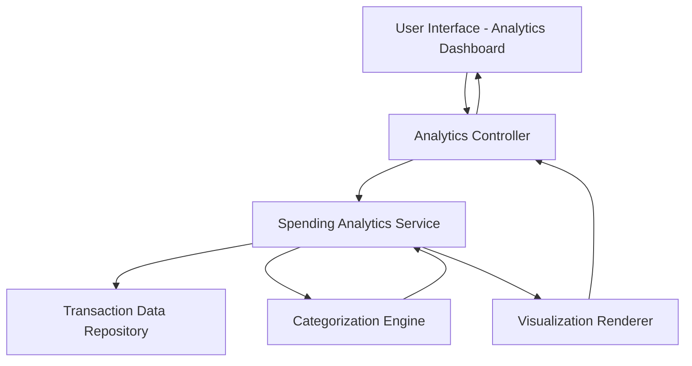

#### 1. High-Level Design

- **Summary:** This epic provides interactive analytics and visualizations for users to understand spending patterns through category-wise analysis and monthly trends. Users can view expense breakdowns across 9 categories (Food & Dining, Fuel, Shopping, Travel, Entertainment, Utilities, Healthcare, Education, Miscellaneous) and perform card-wise spend comparisons for budget management and financial planning.

- **Component Flow:**

- **Integration Points:** 
  - Upstream: Transaction data repository for historical and current transaction records
  - Upstream: Categorization engine for spending classification into 9 predefined categories
  - Downstream: Interactive charts and visualization components for rendering analytics

- **Key Assumptions:** 
  - Transaction data includes sufficient metadata for automatic categorization into the 9 spending categories
  - Monthly aggregation periods align with calendar months or billing cycles

- **NFR Highlights:** Visualizations must render efficiently with responsive design; Analytics must support data aggregation across multiple time periods and categories

#### 2. Validation Report

- **Requirements Coverage:** The design addresses all scope elements including category-wise spending visualization, monthly spend trends, card-wise spend analysis, interactive charts/graphs, and multi-category support for 9 spending categories. The architecture includes dedicated components for categorization, aggregation, and visualization rendering to meet the NFRs for efficient rendering and responsive design.