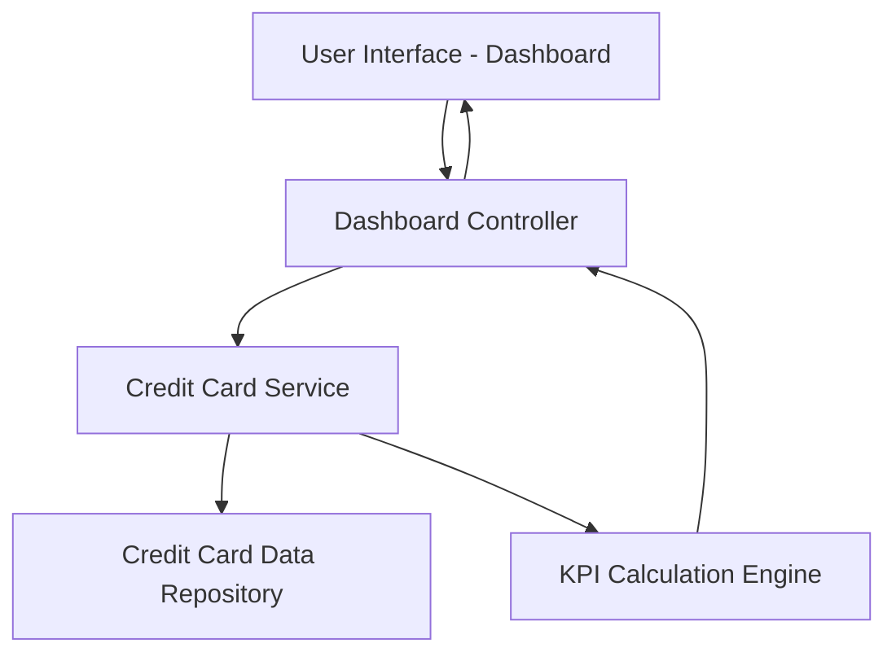

#### 1. High-Level Design

- **Summary:** This epic delivers a consolidated dashboard that displays all user credit cards with key performance indicators (KPIs) including monthly spend, total credit limit, available credit, and outstanding amounts. The solution provides a single-pane-of-glass view for users to monitor their credit card portfolio and financial health across desktop, tablet, and mobile devices.

- **Component Flow:**

- **Integration Points:** 
  - Upstream: Credit card data source or repository for retrieving card details, balances, and credit limits
  - Downstream: User interface layer for responsive rendering across devices

- **Key Assumptions:** 
  - Credit card data is available in a structured format with real-time or near-real-time updates for balances and limits
  - KPI calculations (available credit, outstanding amounts) follow standard credit card industry formulas

- **NFR Highlights:** System must provide responsive layouts across desktop, tablet, and mobile devices; Dashboard must load within acceptable performance thresholds for real-time financial data display

#### 2. Validation Report

- **Requirements Coverage:** The design covers all stated scope items including dashboard KPIs display, multiple credit card view, monthly spend tracking, credit limit aggregation, available credit calculation, outstanding amount display, and responsive layout design. The component architecture supports the NFRs for responsive design and performance thresholds through dedicated UI, service, and calculation layers.