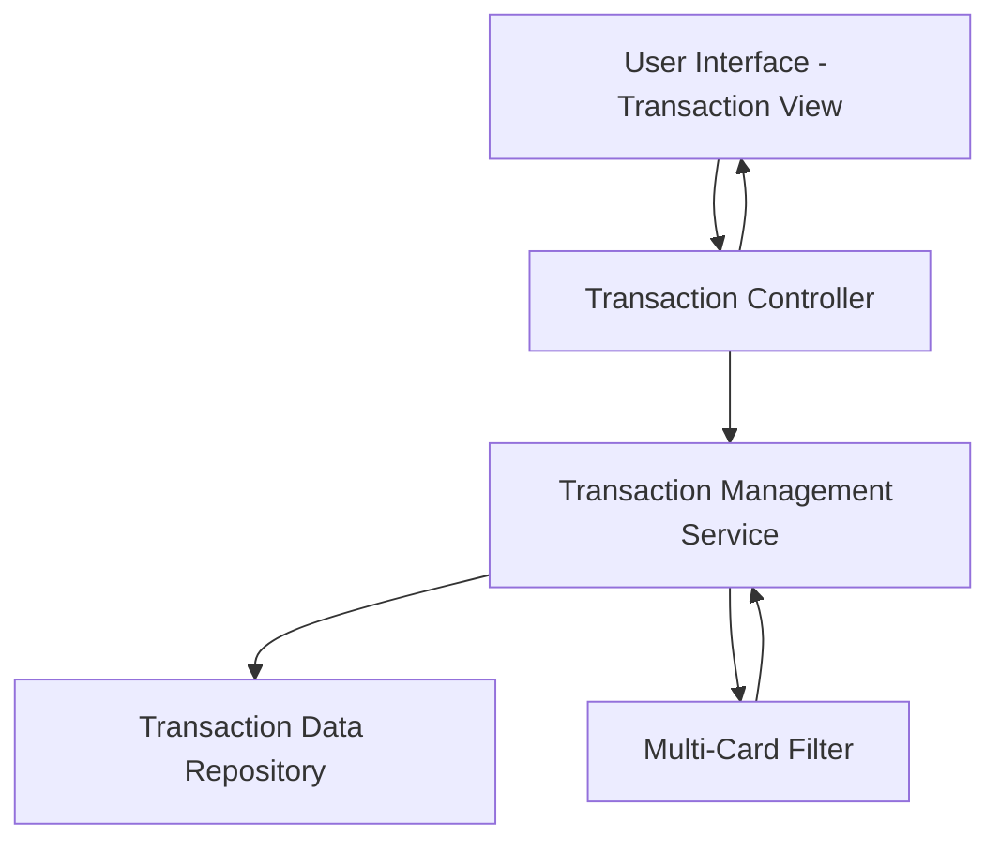

#### 1. High-Level Design

- **Summary:** This epic enables users to view and monitor credit card transactions across all their cards, providing access to transaction history, transaction details, and spending activity tracking. The solution serves as the foundation for spending analytics and helps users maintain awareness of credit card usage patterns through an intuitive and responsive interface.

- **Component Flow:**

- **Integration Points:** 
  - Upstream: Transaction data source or repository for retrieving historical and current transaction records
  - Downstream: Spending analytics components (feeds data to Epic QE-9452)

- **Key Assumptions:** 
  - Transaction data includes standard fields such as date, amount, merchant, category, and card identifier
  - Transaction history retention period is defined by business or regulatory requirements

- **NFR Highlights:** Transaction views must support responsive design across devices; System must handle transaction data retrieval efficiently for multiple cards

#### 2. Validation Report

- **Requirements Coverage:** The design covers all stated scope items including transaction listing, transaction details view, multi-card transaction support, transaction history access, and responsive transaction interface. The architecture supports efficient data retrieval through dedicated service and repository layers, and the multi-card filter component enables the required cross-card transaction monitoring capability while meeting NFRs for responsive design and efficient data handling.