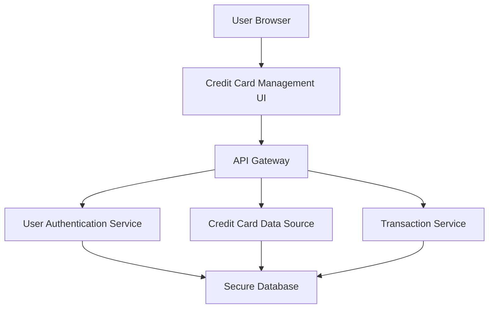

#### 1. High-Level Design

- **Summary:** This epic enables users to manage and monitor multiple credit cards within a unified interface. Users can view a list of all their credit cards, access card-specific details, and analyze spending patterns on a per-card basis. The feature provides card-wise spend analysis, helping users understand individual card utilization, track performance against credit limits, and maintain better control over their credit card portfolio.

- **Component Flow:**

- **Integration Points:**
  - **Upstream:** Credit card data source or mock data service (for card details); User authentication service (for secure card access); Transaction service (for card-wise spending calculations)
  - **Downstream:** Credit Card Management UI displays card list, details, and card-specific analytics

- **Key Assumptions:**
  - Card data is retrieved from a mock data service or simulated backend since real bank integration is out of scope.
  - Card-wise spending calculations are performed by aggregating transactions tagged with specific card identifiers.

- **NFR Highlights:** System must support management of multiple credit cards per user without performance degradation; card data retrieval and display must be secure and encrypted; interface must handle varying numbers of cards efficiently.

#### 2. Validation Report

- **Requirements Coverage:** The design covers all scope elements including multiple credit card display/listing, card-wise spend analysis and breakdown, individual card details view, card selection and filtering, and card-specific credit limit and balance tracking. The architecture supports the NFRs for scalability, security (encryption), and performance. Integration dependencies with authentication, card data source, and transaction service are clearly defined and aligned with the epic's requirements.