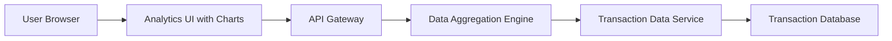

#### 1. High-Level Design

- **Summary:** This epic provides interactive visualizations and analytics to help users understand spending behavior through category-wise analysis and monthly spend trends. Users can explore spending across nine predefined categories (Food & Dining, Fuel, Shopping, Travel, Entertainment, Utilities, Healthcare, Education, Miscellaneous) with interactive charts, filtering, and drill-down capabilities to identify patterns and support budget-conscious decisions.

- **Component Flow:**

- **Integration Points:**
  - **Upstream:** Transaction data service (for retrieving and categorizing spending data); Data aggregation engine (for calculating category totals and trends); Charting library or visualization framework (e.g., Chart.js, D3.js)
  - **Downstream:** Analytics UI renders visualizations based on aggregated data

- **Key Assumptions:**
  - Transaction categorization is automated using predefined rules or merchant codes; manual re-categorization is out of scope.
  - Monthly trends are calculated for the current month and potentially previous months, but multi-period comparisons are excluded per out-of-scope statement.

- **NFR Highlights:** Visualizations must load within acceptable performance thresholds even with large transaction datasets; analytics must accurately categorize transactions; charts must be responsive and interactive across all device types.

#### 2. Validation Report

- **Requirements Coverage:** The design addresses all scope elements including category-wise visualization, monthly spend trend analysis, interactive charts, spending breakdown across all nine categories, transaction categorization/aggregation, and filtering/drill-down capabilities. The architecture supports the NFRs for performance, accuracy, and responsiveness. Integration with transaction data service, aggregation engine, and charting framework is clearly defined.