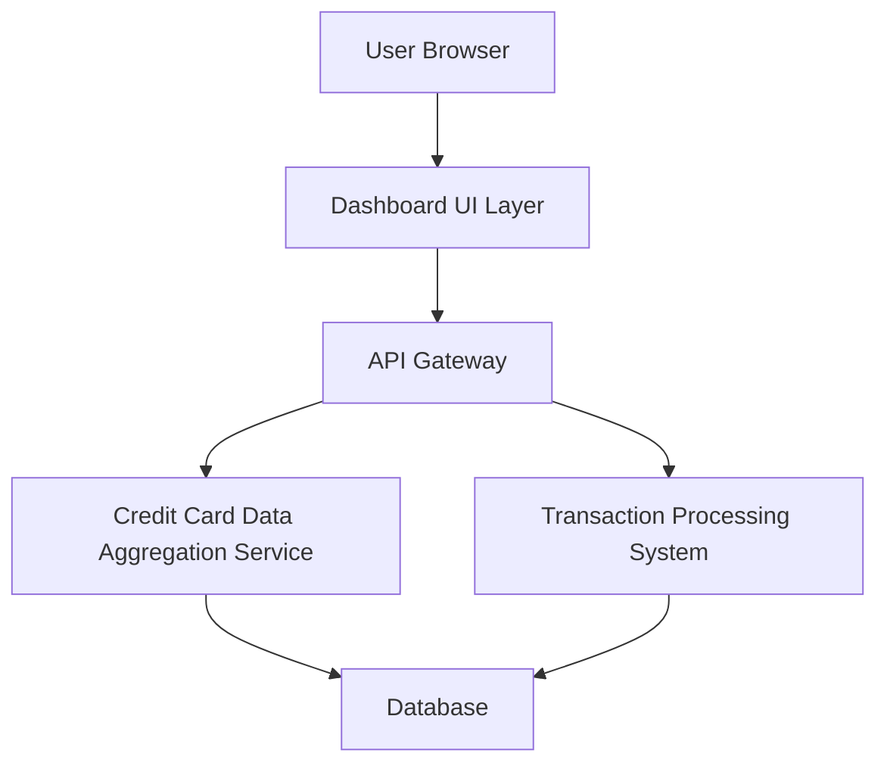

#### 1. High-Level Design

- **Summary:** This epic delivers a responsive dashboard interface that consolidates key performance indicators (KPIs) for a user's credit card portfolio. The dashboard displays four primary metrics: Monthly Spend, Total Credit Limit, Available Credit, and Outstanding Amount. It provides real-time or near-real-time visibility into overall credit card health, enabling users to make informed financial decisions from a centralized location.

- **Component Flow:**

- **Integration Points:**
  - **Upstream:** Credit card data aggregation service (for retrieving card balances and limits); Transaction processing system (for calculating monthly spend and outstanding amounts)
  - **Downstream:** Dashboard UI consumes aggregated data via API Gateway

- **Key Assumptions:**
  - Data refresh frequency is assumed to be near-real-time (e.g., every 5-15 minutes) rather than true real-time streaming.
  - KPI calculations are performed server-side and cached appropriately to optimize performance.

- **NFR Highlights:** Dashboard must be responsive across desktop, tablet, and mobile devices; page load time optimized for quick KPI access; supports real-time or near-real-time data refresh.

#### 2. Validation Report

- **Requirements Coverage:** The design covers all stated scope elements including dashboard interface, all four KPI displays (Monthly Spend, Total Credit Limit, Available Credit, Outstanding Amount), responsive layout, and consolidated view. The architecture supports the NFRs for responsiveness, performance, and data freshness. Integration dependencies are clearly identified and addressed through the API Gateway pattern.