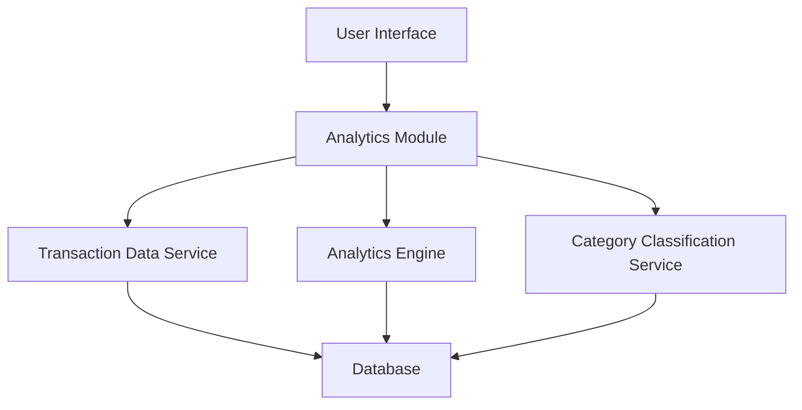

#### 1. High-Level Design

- **Summary:** This epic delivers interactive data visualizations and analytics to help users understand spending patterns through category-wise breakdowns, monthly trends, and card-wise comparisons. The system aggregates transaction data across 9 predefined categories and presents insights through responsive, interactive charts.

- **Component Flow:**

- **Integration Points:** 
  - **Upstream:** Transaction data service for spending data
  - **Upstream:** Analytics engine for data aggregation and visualization
  - **Upstream:** Category classification service for transaction categorization
  - **Downstream:** Interactive charting library for rendering visualizations

- **Key Assumptions:** 
  - Transactions are pre-classified or can be classified into the 9 predefined categories (Food & Dining, Fuel, Shopping, Travel, Entertainment, Utilities, Healthcare, Education, Miscellaneous)
  - Historical data is retained for at least 12 months to support meaningful trend analysis

- **NFR Highlights:** Analytics visualizations must render within 3 seconds; charts must be interactive and responsive across all device types; system must support historical data analysis for trend identification

- **Data Flow:** User accesses analytics dashboard → Analytics Module requests transaction data from Transaction Data Service → Category Classification Service categorizes transactions → Analytics Engine aggregates data by category, time period, and card → Processed insights are formatted for visualization → Interactive charts render on UI showing spending patterns, trends, and card-wise comparisons

#### 2. Validation Report

- **Requirements Coverage:** The design comprehensively addresses the epic's scope including category-wise visualization, monthly trend analysis, card-wise spend analysis, and interactive charts. The architecture incorporates all three required dependencies (transaction data service, analytics engine, category classification service) and supports the 9 predefined spending categories. The component flow ensures visualization rendering within 3 seconds and provides the necessary data aggregation for pattern identification and trend analysis across devices.