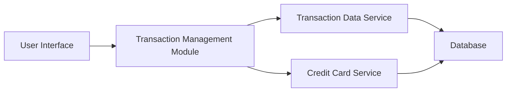

#### 1. High-Level Design

- **Summary:** This epic enables users to view, search, and filter credit card transactions across multiple cards through a unified interface. The system retrieves transaction history from backend services and presents it in a sortable, user-friendly format with detailed transaction views.

- **Component Flow:**

- **Integration Points:** 
  - **Upstream:** Transaction data service for retrieving transaction records
  - **Upstream:** Credit card service for associating transactions with specific cards
  - **Downstream:** User interface for displaying transaction data

- **Key Assumptions:** 
  - Transaction data is available in a standardized format from the transaction data service
  - Filtering and searching will be performed on predefined transaction attributes (date, amount, merchant, category)

- **NFR Highlights:** Transaction queries must return results within 1 second; system must handle transaction history for multiple cards efficiently with user-friendly, sortable data display

- **Data Flow:** User requests transaction history through the UI → Transaction Management Module queries Transaction Data Service and Credit Card Service → Services retrieve transaction records and card associations from Database → Data is aggregated, sorted, and returned to UI → User views transactions with filtering and search capabilities

#### 2. Validation Report

- **Requirements Coverage:** The design fully covers the epic's stated scope including transaction listing, history viewing, multi-card support, and detail views. The architecture supports filtering and searching capabilities as specified, with clear integration points to transaction and credit card services. The component flow ensures sub-second query response times through efficient service-to-database interactions and supports the sortable data display requirement.