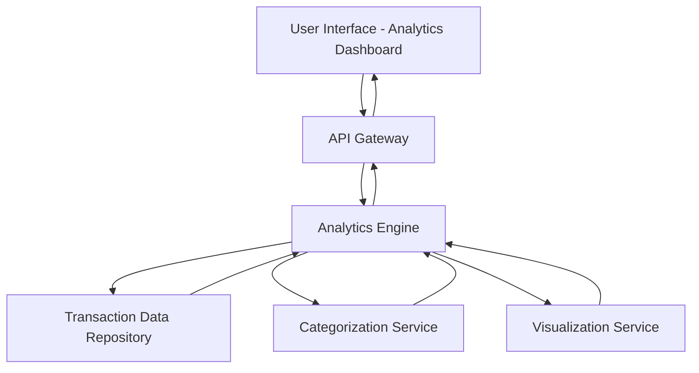

#### 1. High-Level Design

- **Summary:** This epic provides comprehensive analytics and visualization capabilities including monthly spend trend analysis and category-wise spending breakdowns across 9 predefined categories (Food & Dining, Fuel, Shopping, Travel, Entertainment, Utilities, Healthcare, Education, Miscellaneous), enabling users to identify spending patterns and make data-driven financial decisions.

- **Component Flow:**

- **Integration Points:**
  - **Upstream:** Transaction categorization service/engine for assigning categories to transactions
  - **Upstream:** Transaction data repository for historical transaction data
  - **Upstream:** Data analytics or visualization libraries (e.g., Chart.js, D3.js) for rendering
  - **Downstream:** Interactive chart components in UI

- **Key Assumptions:**
  - Transactions are pre-categorized or categorization happens asynchronously before analytics queries
  - Historical data is retained for at least 12-24 months to support meaningful trend analysis

- **NFR Highlights:** Visualizations must load within acceptable response times; analytics engine must process and aggregate transaction data efficiently; charts must be interactive and responsive across devices; system must handle historical data for trend analysis

- **Data Flow:** User accesses analytics dashboard → API Gateway routes to Analytics Engine → Engine queries Transaction Data Repository for historical transactions → Categorization Service ensures transactions are properly categorized across 9 categories → Analytics Engine aggregates data by category and time period (monthly trends) → Aggregated data passed to Visualization Service for chart generation → Interactive charts and category breakdowns returned to UI → User interacts with visualizations to drill down into specific categories or time periods

#### 2. Validation Report

- **Requirements Coverage:** The design comprehensively covers all scope items including category-wise spending visualization for all 9 categories, monthly spend trends analysis, interactive charts and graphs, spending pattern identification, and multi-category breakdown. The architecture supports the NFRs for acceptable response times, efficient data processing and aggregation, interactive and responsive charts, and historical data handling through dedicated Analytics Engine, Categorization Service, and Visualization Service components with optimized data aggregation and caching strategies.