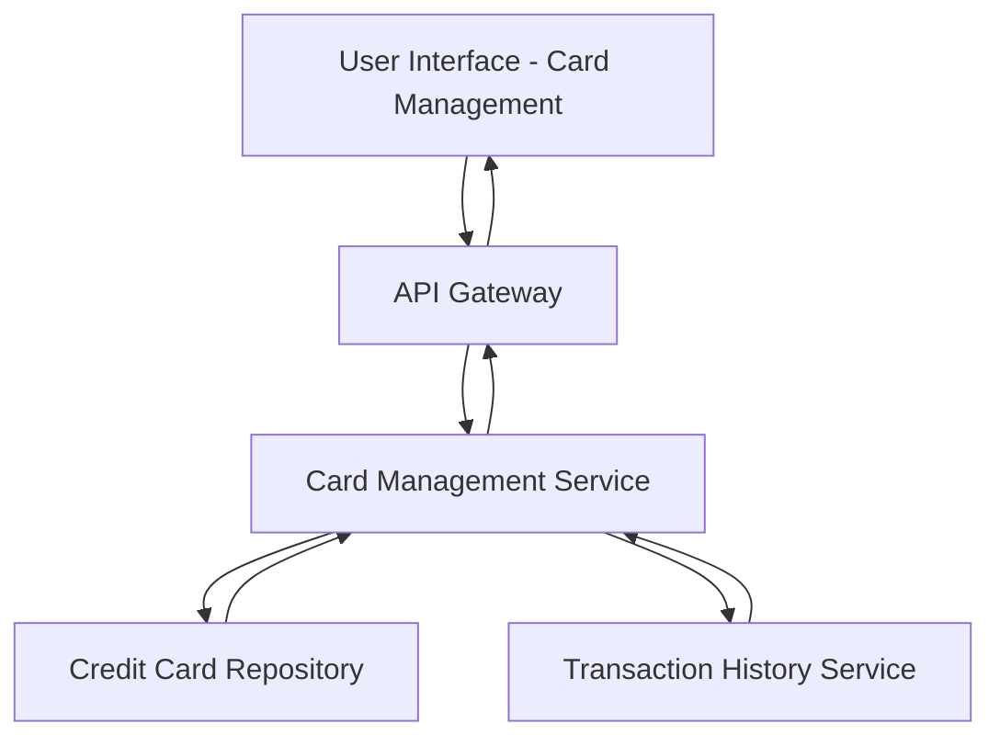

#### 1. High-Level Design

- **Summary:** This epic enables users to manage and monitor multiple credit cards (10+) within a unified interface, providing card-wise spend analysis, individual card details, comparison capabilities, and transaction listings for each card.

- **Component Flow:**

- **Integration Points:**
  - **Upstream:** Credit card data repository/database for card details and metadata
  - **Upstream:** Transaction history service for per-card transaction data
  - **Upstream:** Card issuer data feeds (optional integration for real-time card data)
  - **Downstream:** Card display and comparison UI components

- **Key Assumptions:**
  - Card data is stored in a normalized database structure with unique card identifiers
  - Transaction history is pre-associated with card IDs for efficient filtering and retrieval

- **NFR Highlights:** System must support display of at least 10+ credit cards per user; card data retrieval must be efficient with minimal latency; interface must maintain performance with large transaction volumes per card

- **Data Flow:** User accesses card management interface → API Gateway routes to Card Management Service → Service retrieves all user cards from Credit Card Repository → For selected card(s), service fetches transaction history from Transaction History Service → Card details, spend analysis, and transaction listings returned to UI → User can filter, compare, and analyze individual cards → Selection/filtering requests trigger targeted data retrieval for specific cards

#### 2. Validation Report

- **Requirements Coverage:** The design addresses all scope items including multiple card display, card-wise spend analysis, individual card details view, comparison capabilities, card selection/filtering, and transaction listing per card. The architecture supports the NFRs for 10+ cards, efficient retrieval with minimal latency, and performance with large transaction volumes through dedicated Card Management and Transaction History services with optimized data access patterns.