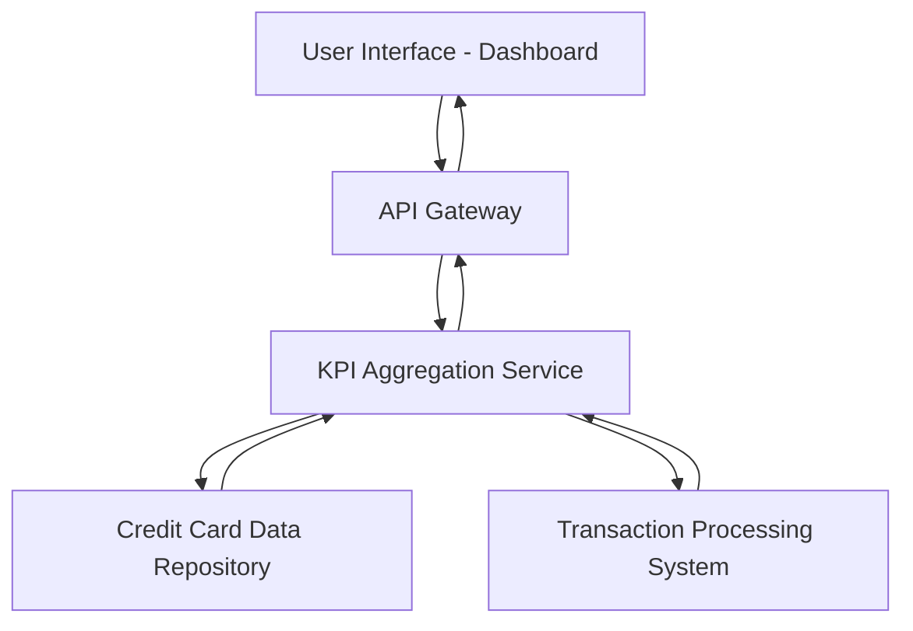

#### 1. High-Level Design

- **Summary:** This epic delivers a responsive dashboard that consolidates key financial metrics (Monthly Spend, Total Credit Limit, Available Credit, Outstanding Amount) across all user credit cards into a single view, enabling users to monitor their financial health at a glance.

- **Component Flow:**

- **Integration Points:**
  - **Upstream:** Credit card data source/repository for card details and balances
  - **Upstream:** Transaction processing system for spend calculations
  - **Upstream:** User authentication service for secure access
  - **Downstream:** Dashboard UI rendering engine

- **Key Assumptions:**
  - KPI data is refreshed at regular intervals (e.g., every 5-15 minutes) rather than true real-time streaming
  - Credit card data repository provides standardized data format with fields for limit, balance, and outstanding amounts

- **NFR Highlights:** Dashboard must be responsive across desktop, tablet, and mobile devices; page load time optimized for quick KPI access; supports real-time or near-real-time data refresh

- **Data Flow:** User authenticates and accesses dashboard → API Gateway routes request to KPI Aggregation Service → Service queries Credit Card Data Repository for card limits and balances → Service queries Transaction Processing System for monthly spend calculations → Aggregated KPI data (Monthly Spend, Total Credit Limit, Available Credit, Outstanding Amount) returned to UI → Dashboard renders consolidated view with all KPIs displayed

#### 2. Validation Report

- **Requirements Coverage:** The design fully covers the epic's scope including all four KPIs (Monthly Spend, Total Credit Limit, Available Credit, Outstanding Amount), responsive layout, and consolidated view interface. The architecture supports the NFRs for responsiveness, optimized load times, and near-real-time refresh through the KPI Aggregation Service pattern.