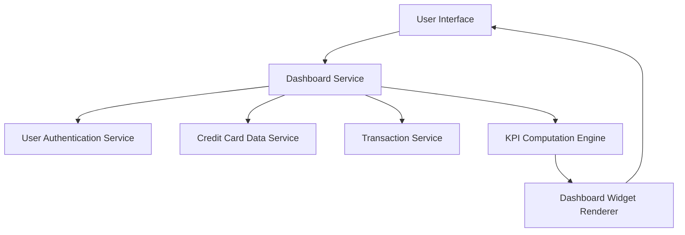

#### 1. High-Level Design

- **Summary:** This epic provides users with a consolidated dashboard displaying critical financial KPIs including monthly spend, total credit limit, available credit, and outstanding amount across all credit cards. The dashboard offers a single-pane-of-glass view for immediate visibility into overall credit card financial health.

- **Component Flow:**

- **Integration Points:**
  - **Upstream:** User authentication service for user-specific data access; Credit Card data service for card details (limits, balances); Transaction service for spending calculations
  - **Downstream:** KPI Computation Engine for aggregating metrics; Dashboard Widget Renderer for responsive visualization

- **Key Assumptions:**
  - KPIs are computed in real-time or near-real-time based on latest transaction and card balance data.
  - Dashboard supports auto-refresh mechanism to keep KPIs current without manual user intervention.

- **NFR Highlights:** Dashboard must load within 2 seconds, support responsive design for mobile and desktop devices, handle real-time data refresh for KPI updates.

- **Data Flow:** User logs in → User Authentication Service validates credentials → Dashboard Service retrieves user's credit cards from Credit Card Data Service → Transaction Service provides monthly spending data → KPI Computation Engine calculates total credit limit (sum of all card limits), available credit (total limit minus outstanding), outstanding amount (sum of all card balances), and monthly spend → Dashboard Widget Renderer displays KPIs in responsive layout with visual indicators (progress bars, gauges) → Dashboard auto-refreshes periodically to update KPIs with latest data.

#### 2. Validation Report

- **Requirements Coverage:** The design fully addresses the epic's scope including monthly spend calculation and display, total credit limit aggregation, available credit computation, outstanding amount tracking, responsive dashboard layout, and KPI visualization widgets. All NFRs (2-second load time, responsive design, real-time data refresh) are covered through the Dashboard Service architecture with KPI Computation Engine and Widget Renderer. Dependencies on Credit Card data service, Transaction service, and User authentication service are explicitly mapped and integrated into the data flow.