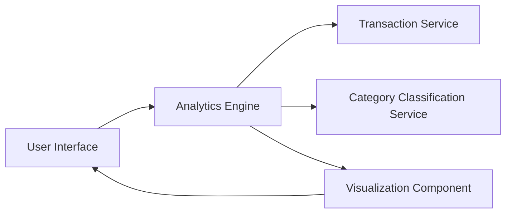

#### 1. High-Level Design

- **Summary:** This epic delivers interactive visualizations and analytics to help users understand spending patterns through category-wise analysis and monthly trends. Users can view spending breakdowns across nine predefined categories (Food & Dining, Fuel, Shopping, Travel, Entertainment, Utilities, Healthcare, Education, Miscellaneous) with actionable insights for financial decision-making.

- **Component Flow:**

- **Integration Points:**
  - **Upstream:** Transaction service for raw transaction data; Category classification service for transaction categorization into nine predefined categories
  - **Downstream:** Data analytics engine for trend computation and pattern identification; Visualization component for rendering charts and graphs

- **Key Assumptions:**
  - Transactions are automatically categorized by the Category classification service using predefined rules or ML models.
  - Historical transaction data is available for at least 12 months to enable meaningful trend analysis.

- **NFR Highlights:** Analytics visualizations must render within 3 seconds, support interactive filtering and drill-down capabilities, handle historical data for trend analysis.

- **Data Flow:** User requests analytics view → Analytics Engine retrieves transaction data from Transaction Service → Category Classification Service categorizes transactions into nine categories → Analytics Engine computes spending totals per category and monthly trends → Visualization Component generates interactive charts (pie charts for category breakdown, line charts for monthly trends) → User interacts with filters (date range, category) → Analytics Engine re-computes and updates visualizations in real-time.

#### 2. Validation Report

- **Requirements Coverage:** The design comprehensively covers the epic's scope including category-wise spending visualization, monthly spend trend analysis, interactive charts, spending breakdown by nine categories, transaction categorization, and pattern identification. All NFRs (3-second rendering, interactive filtering, historical data handling) are addressed through the Analytics Engine and Visualization Component architecture. Dependencies on Transaction service, Category classification service, and Data analytics engine are explicitly integrated into the component flow.