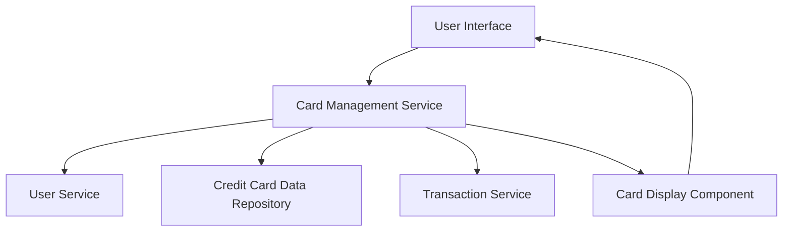

#### 1. High-Level Design

- **Summary:** This epic enables users to manage and view multiple credit cards within a unified interface. The system consolidates card details including credit limits, balances, usage, and card-specific spending analysis, eliminating the need for users to access multiple banking platforms.

- **Component Flow:**

- **Integration Points:**
  - **Upstream:** User service for user identification and authentication
  - **Downstream:** Credit Card data repository for retrieving card information; Transaction service for card-wise spending data aggregation

- **Key Assumptions:**
  - Card data is stored in a structured format with standardized fields (card number, limit, balance, issuer).
  - Transaction data is pre-tagged with card identifiers for efficient card-wise spend analysis.

- **NFR Highlights:** System must support minimum 10 credit cards per user, card data retrieval within 1 second, responsive interface across all device types.

- **Data Flow:** User authenticates → User Service validates identity → Card Management Service queries Credit Card Data Repository for user's cards → Transaction Service aggregates spending per card → Card Display Component renders card list with details (limit, balance, usage) → User selects card → Detailed card-specific view with spending analysis is displayed.

#### 2. Validation Report

- **Requirements Coverage:** The design fully covers the epic's stated scope including display of multiple cards, card-wise spend analysis, card detail views, card selection/switching, and card-specific credit limit and balance display. All NFRs (10 cards minimum, 1-second retrieval, responsive design) are addressed through service architecture and data repository design. Integration dependencies with User service, Credit Card repository, and Transaction service are explicitly mapped.