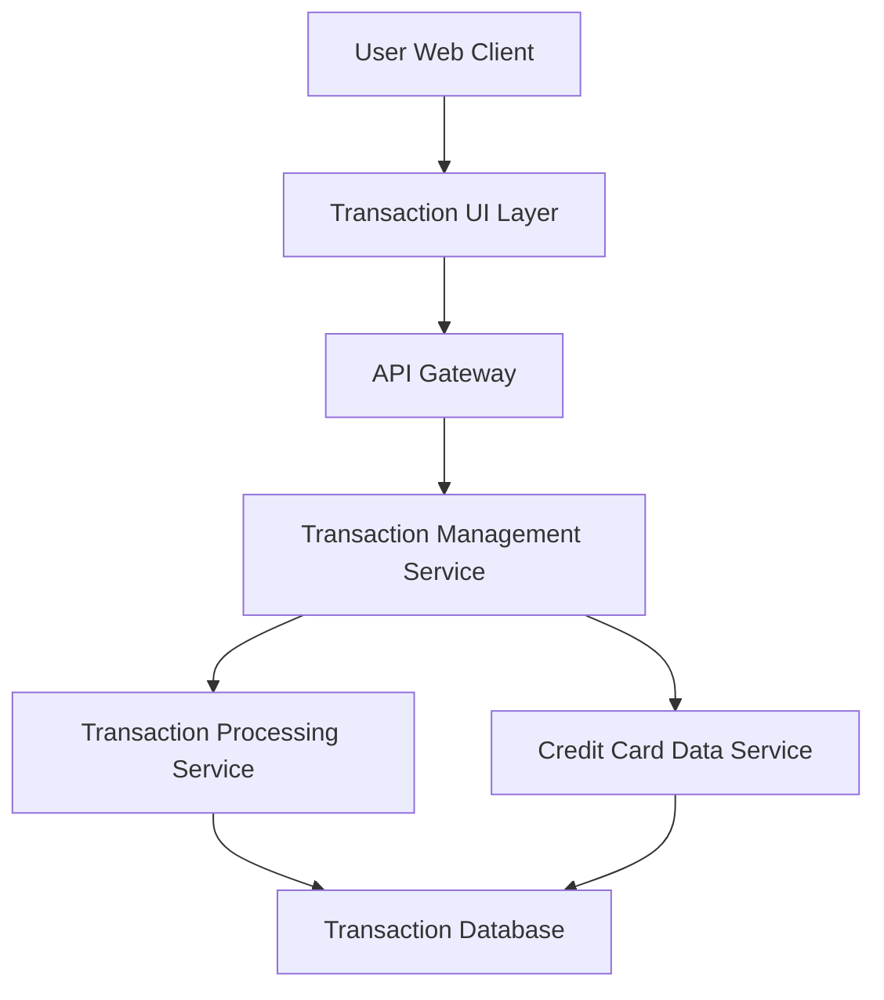

#### 1. High-Level Design

- **Summary:** This epic provides users with comprehensive transaction viewing and monitoring capabilities across all their credit cards. Users can access detailed transaction histories, view transaction details, and filter transactions by card, enabling complete spending visibility and verification of charges from a single consolidated interface.

- **Component Flow:**

- **Integration Points:** 
  - **Upstream:** Transaction Processing Service (primary source for retrieving transaction data and histories)
  - **Upstream:** Credit Card Data Service (links transactions to specific credit cards and provides card metadata)
  - **Downstream:** Transaction UI displays paginated transaction lists with filtering and detail views

- **Key Assumptions:** 
  - Transactions are stored with standardized metadata (date, amount, merchant, category, card ID) in the Transaction Processing Service
  - Pagination defaults to 50 transactions per page; filtering is performed server-side for performance

- **NFR Highlights:** Transaction list should load within 1.5 seconds; Support pagination for large transaction volumes; System must handle transaction data for users with multiple credit cards efficiently

- **Data Flow:** User accesses transaction view via web client → Transaction UI sends request with optional filters (card ID, date range) through API Gateway → Transaction Management Service calls Transaction Processing Service to retrieve paginated transaction data and Credit Card Data Service to enrich with card details → Services query Transaction Database → Transaction Management Service aggregates and formats transaction records → API Gateway returns paginated JSON response → Transaction UI renders transaction list with card associations, merchant names, amounts, dates, and categories → User can click for detailed transaction view or apply filters to refine results.

#### 2. Validation Report

- **Requirements Coverage:** The design comprehensively covers all scope elements: Transaction listing, Transaction details view, Multi-card transaction aggregation, Transaction history access, and Transaction filtering by card. The NFRs (1.5-second load time, pagination support, efficient multi-card handling) are addressed through server-side pagination, optimized database queries, and lightweight service architecture. Integration dependencies (Transaction Processing Service and Credit Card Data Service) are properly mapped. The design excludes out-of-scope items (real bank integration, payments, disputes) as specified.