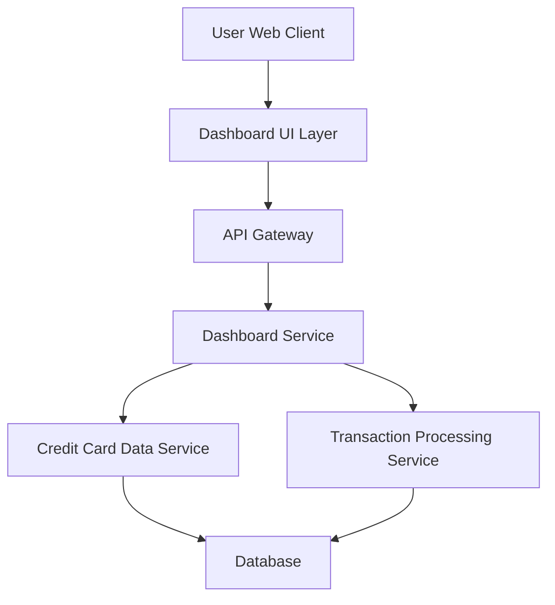

#### 1. High-Level Design

- **Summary:** This epic delivers a consolidated dashboard that aggregates and displays key performance indicators (KPIs) for all user credit cards in a single responsive interface. The dashboard provides real-time visibility into monthly spend, total credit limit, available credit, and outstanding amounts across multiple cards, enabling users to monitor their overall credit card health at a glance.

- **Component Flow:**

- **Integration Points:** 
  - **Upstream:** Credit Card Data Service (retrieves card details, credit limits, and current balances)
  - **Upstream:** Transaction Processing Service (calculates monthly spend and outstanding amounts)
  - **Downstream:** Dashboard UI renders aggregated KPI data for end-user consumption

- **Key Assumptions:** 
  - KPI data is refreshed in near real-time (assumed refresh interval: 30-60 seconds or on-demand user refresh)
  - Credit card data is already available in the Credit Card Data Service; no direct bank API integration is required

- **NFR Highlights:** Dashboard must be responsive across desktop, tablet, and mobile devices; Page load time must be under 2 seconds; Support real-time data refresh for KPI metrics

- **Data Flow:** User accesses the dashboard via web client → Dashboard UI requests aggregated KPI data through API Gateway → Dashboard Service orchestrates calls to Credit Card Data Service (for card details, limits, balances) and Transaction Processing Service (for monthly spend, outstanding amounts) → Services query the database and return data → Dashboard Service aggregates and calculates KPIs (total credit limit, available credit, outstanding amounts, monthly spend) → API Gateway returns JSON response to UI → Dashboard UI renders KPIs in responsive layout with visual indicators for credit utilization and financial health.

#### 2. Validation Report

- **Requirements Coverage:** The design fully addresses the epic's stated scope including Dashboard KPIs display, Monthly Spend tracking, Total Credit Limit aggregation, Available Credit calculation, Outstanding Amount tracking, Multiple credit cards view, Consolidated interface, and Responsive layout. All NFRs (responsiveness, 2-second load time, real-time refresh) are architecturally supported through lightweight service calls and efficient data aggregation. The integration dependencies (Credit Card Data Service and Transaction Processing Service) are clearly mapped in the component flow.