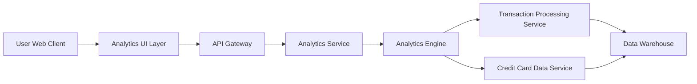

#### 1. High-Level Design

- **Summary:** This epic delivers interactive visualizations and analytics capabilities that enable users to understand spending patterns across multiple dimensions including monthly trends, card-wise breakdowns, and category-wise analysis across nine predefined categories (Food & Dining, Fuel, Shopping, Travel, Entertainment, Utilities, Healthcare, Education, Miscellaneous). The analytics empower users to identify spending patterns and make informed financial decisions.

- **Component Flow:**

- **Integration Points:** 
  - **Upstream:** Transaction Processing Service (aggregates spending data by time period, category, and card)
  - **Upstream:** Analytics Engine (calculates trends, breakdowns, and spending patterns)
  - **Upstream:** Credit Card Data Service (provides card-wise analysis context)
  - **Downstream:** Analytics UI renders interactive charts and visualizations (line charts for trends, pie/bar charts for breakdowns)

- **Key Assumptions:** 
  - Transaction categorization is pre-assigned by Transaction Processing Service using the nine predefined categories
  - Analytics data is pre-aggregated for performance; historical data up to 12 months is retained in Data Warehouse

- **NFR Highlights:** Analytics visualizations must be interactive and responsive; Chart rendering time must be under 1 second; Support data aggregation for up to 12 months of historical spending data

- **Data Flow:** User accesses analytics dashboard via web client → Analytics UI requests specific analytics (monthly trends, card-wise spend, category breakdown) through API Gateway → Analytics Service calls Analytics Engine with query parameters (time range, card IDs, categories) → Analytics Engine retrieves pre-aggregated data from Transaction Processing Service and enriches with card context from Credit Card Data Service → Data is pulled from Data Warehouse with optimized queries → Analytics Engine calculates trends, percentages, and breakdowns → API Gateway returns structured JSON with visualization data (time series for trends, aggregated amounts by card/category) → Analytics UI renders interactive charts using JavaScript charting library with drill-down capabilities and responsive design.

#### 2. Validation Report

- **Requirements Coverage:** The design fully addresses all scope elements: Monthly Spend Trends visualization, Card-wise Spend Analysis, Category-wise Spending breakdown across all nine categories (Food & Dining, Fuel, Shopping, Travel, Entertainment, Utilities, Healthcare, Education, Miscellaneous), Interactive visualizations, and Spending pattern identification. All NFRs are architecturally supported: interactive and responsive visualizations through modern charting libraries, sub-1-second chart rendering via pre-aggregated data and optimized queries, and 12-month historical data support through Data Warehouse. Integration dependencies (Transaction Processing Service, Analytics Engine, Credit Card Data Service) are properly mapped. Out-of-scope items (predictive analytics, budget recommendations, spending alerts, export functionality) are correctly excluded.