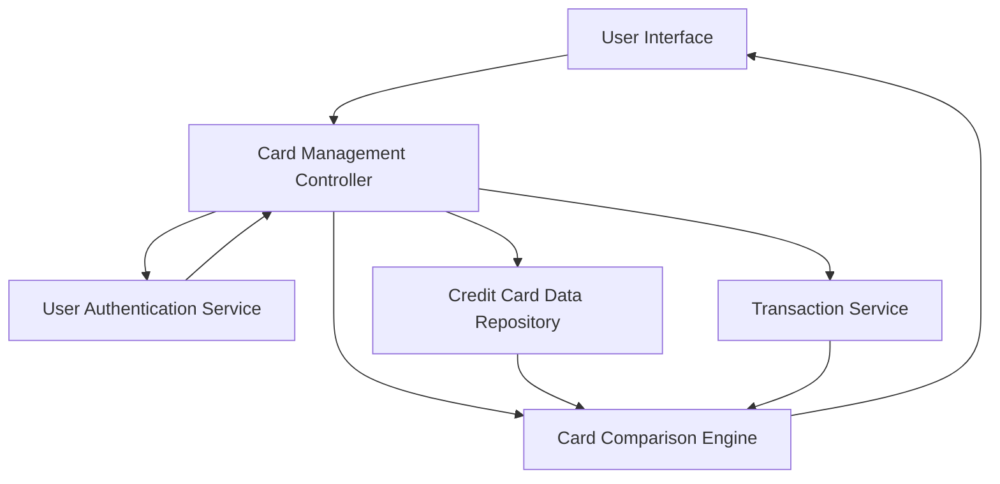

#### 1. High-Level Design

- **Summary**: This epic provides a unified interface for users to manage and view multiple credit cards (up to 20 per user). Users can access individual card details, perform card-wise spend analysis, compare performance across cards, and navigate seamlessly between cards. The solution consolidates multi-card management into a single view with card-specific insights.

- **Component Flow**:

- **Integration Points**: 
  - **Upstream**: Credit Card Data Repository (for retrieving card details with masked card numbers)
  - **Upstream**: User Authentication Service (for secure card access authorization)
  - **Upstream**: Transaction Service (for card-specific spending data and analysis)

- **Key Assumptions**: 
  - Card numbers are stored securely with encryption and displayed with masking (e.g., last 4 digits visible).
  - Card comparison logic uses standardized metrics (spend, utilization, outstanding) calculated by the backend.

- **NFR Highlights**: System must support up to 20 credit cards per user with card data retrieval latency under 300ms and ensure secure storage and display of card information with masked card numbers.

- **Data Flow**: User logs in → User Authentication Service validates access → Card Management Controller retrieves all user cards from Credit Card Data Repository → For each card, controller fetches spending data from Transaction Service → Card Comparison Engine processes card-specific metrics → User Interface displays all cards with individual details, spend analysis, and comparison capabilities → User can filter, select, and navigate between cards with sub-300ms latency.

#### 2. Validation Report

- **Requirements Coverage**: The design fully satisfies the epic's scope including multiple credit card display, card-wise spend analysis, individual card details view, card comparison capabilities, and card selection/filtering. All NFRs are addressed: support for up to 20 cards per user, sub-300ms retrieval latency through optimized data access, and secure storage/display with masked card numbers. All dependencies on credit card data repository, user authentication, and transaction service are properly integrated. Out-of-scope items (real bank integration, payment functionality, card application, credit score, rewards) are correctly excluded.