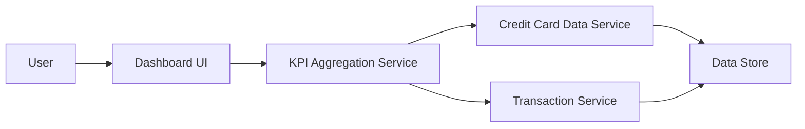

#### 1. High-Level Design

- **Summary**: This epic establishes a centralized dashboard that displays critical financial KPIs including monthly spend, total credit limit across all cards, available credit, and outstanding amounts. The dashboard provides real-time consolidated views to help users monitor their credit utilization and payment obligations at a glance.

- **Component Flow**:

- **Integration Points**: 
  - **Upstream**: Credit Card Data Service (for retrieving card balances, limits, and outstanding amounts)
  - **Upstream**: Transaction Service (for calculating monthly spend aggregations)

- **Key Assumptions**: 
  - Credit card data is refreshed in near real-time or at intervals sufficient to meet the 2-second load requirement.
  - Monthly spend is calculated based on the current calendar month with timezone considerations handled by the backend.

- **NFR Highlights**: Dashboard must load within 2 seconds, support responsive design for mobile and desktop, handle real-time data refresh, and ensure data accuracy across all KPI calculations.

- **Data Flow**: User accesses dashboard → Dashboard UI requests KPI data from KPI Aggregation Service → Service fetches card balances and limits from Credit Card Data Service and monthly spend from Transaction Service → Aggregation Service calculates total credit limit, available credit, and outstanding amounts → Consolidated KPIs are returned to Dashboard UI → Responsive dashboard renders KPIs with real-time refresh capability.

#### 2. Validation Report

- **Requirements Coverage**: The design comprehensively addresses all stated requirements including monthly spend display, total credit limit aggregation, available credit calculation, outstanding amount tracking, responsive layout, and KPI visualization. All NFRs are covered: 2-second load time through efficient aggregation, responsive design support, real-time refresh capability, and data accuracy through direct integration with authoritative data services. Dependencies on credit card data and transaction services are properly identified and integrated.