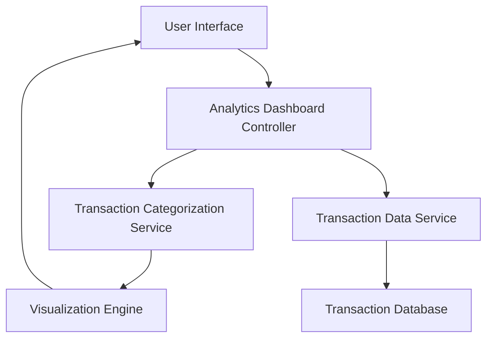

#### 1. High-Level Design

- **Summary**: This epic delivers an analytics module that enables users to visualize and understand their spending patterns across nine predefined categories (Food & Dining, Fuel, Shopping, Travel, Entertainment, Utilities, Healthcare, Education, Miscellaneous). The solution provides interactive visualizations, monthly trend analysis, and spending pattern identification to support informed financial decision-making.

- **Component Flow**:

- **Integration Points**: 
  - **Upstream**: Transaction Categorization Service (for expense classification into 9 categories)
  - **Upstream**: Transaction Data Service (for retrieving historical spending data up to 12 months)
  - **External**: Visualization Library (for rendering charts and graphs)

- **Key Assumptions**: 
  - Transactions are pre-categorized by the Transaction Categorization Service or have sufficient metadata for automatic classification.
  - Monthly spend trends are calculated on-demand with caching for performance optimization.

- **NFR Highlights**: Analytics must process and display up to 12 months of transaction history with visualization rendering within 1.5 seconds and interactive filtering response under 500ms.

- **Data Flow**: User requests analytics view → Analytics Dashboard Controller fetches transaction data from Transaction Data Service → Transaction Categorization Service classifies expenses into 9 categories → Visualization Engine processes categorized data and generates charts → Interactive visualizations are rendered on User Interface with filtering capabilities for monthly trends and category breakdowns.

#### 2. Validation Report

- **Requirements Coverage**: The design fully covers the epic's stated scope including category-wise visualization, monthly trend analysis, interactive dashboard, support for nine spending categories, and pattern identification. All NFRs regarding 12-month history processing, 1.5-second rendering, and 500ms filtering response are addressed through the architecture. Integration dependencies with transaction categorization and data services are properly mapped.