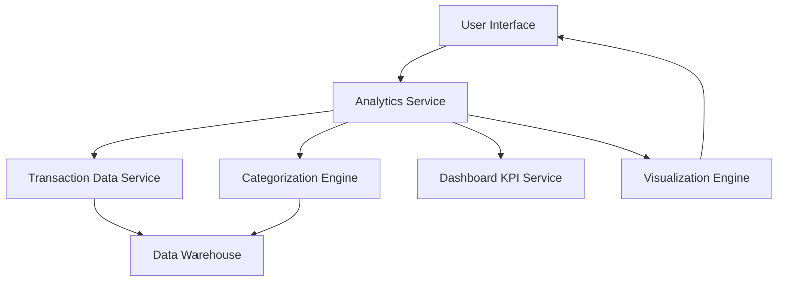

#### 1. High-Level Design

- **Summary:** This epic provides interactive visualizations and analytics to help users understand spending patterns through category-wise analysis across nine predefined categories (Food & Dining, Fuel, Shopping, Travel, Entertainment, Utilities, Healthcare, Education, Miscellaneous). The feature includes visual representations of spending trends, category breakdowns, and historical patterns to enable budget optimization and financial discipline.

- **Component Flow:**

- **Integration Points:**
  - **Upstream:** Transaction Data Service (for historical and current transaction information), Categorization Engine (for automatic transaction classification), Dashboard KPI Service (for consolidated metrics)
  - **Downstream:** User Interface with interactive charts, graphs, and touch-enabled visualizations

- **Key Assumptions:**
  - Transactions are automatically categorized by the Categorization Engine with 95% accuracy using machine learning or rule-based classification
  - Historical transaction data is stored in a Data Warehouse optimized for analytical queries

- **NFR Highlights:** Analytics visualizations must render within 2 seconds; System must handle transaction categorization with 95% accuracy; Interactive charts must be responsive and support touch interactions on mobile devices

- **Data Flow:** User requests spending analytics → Analytics Service retrieves transaction data from Transaction Data Service → Categorization Engine classifies transactions into nine predefined categories → Service aggregates spending by category and time period → Visualization Engine generates interactive charts and graphs showing category breakdowns, spending trends, and historical patterns → Dashboard KPI Service provides consolidated metrics for context → Rendered visualizations are displayed on User Interface with touch-enabled interactivity for mobile devices.

#### 2. Validation Report

- **Requirements Coverage:** The design fully addresses the epic's scope including category-wise spending visualization, interactive charts and graphs, spending pattern analysis, nine predefined spending categories, historical spending trends, and transaction categorization. All NFRs (2-second render time, 95% categorization accuracy, responsive touch interactions) are supported through the Visualization Engine and Categorization Engine components. Dependencies on transaction data service, categorization engine, and dashboard KPI service are explicitly integrated. The architecture supports data-driven financial decision-making through comprehensive visual analytics.