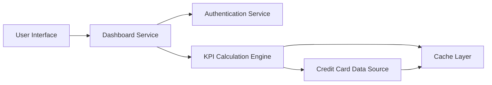

#### 1. High-Level Design

- **Summary:** This epic delivers a consolidated financial overview dashboard displaying key performance indicators (KPIs) for credit card management. The dashboard presents real-time metrics including Monthly Spend, Total Credit Limit, Available Credit, and Outstanding Amount across all user credit cards in a unified interface, enabling informed spending decisions and effective credit utilization management.

- **Component Flow:**

- **Integration Points:**
  - **Upstream:** Credit Card Data Sources (for balance, limit, and transaction information), User Authentication Service (for secure access control)
  - **Downstream:** User Interface for real-time KPI visualization and dashboard rendering

- **Key Assumptions:**
  - Credit card data sources provide APIs with sub-second response times for real-time data retrieval
  - KPI calculations are performed server-side with results cached for performance optimization

- **NFR Highlights:** Dashboard must load within 2 seconds; System must support responsive layouts across desktop, tablet, and mobile devices; Data refresh must occur in real-time or near real-time

- **Data Flow:** User logs in via Authentication Service → Dashboard Service validates user session → KPI Calculation Engine retrieves credit card data (balances, limits, transactions) from Credit Card Data Sources → Engine calculates Monthly Spend, Total Credit Limit, Available Credit, and Outstanding Amount → Results are cached for performance → Consolidated KPIs are rendered on User Interface in real-time with responsive layout adapting to device type.

#### 2. Validation Report

- **Requirements Coverage:** The design comprehensively addresses all stated requirements including the four core KPIs (Monthly Spend, Total Credit Limit, Available Credit, Outstanding Amount), consolidated view of all credit cards, and real-time financial metrics display. NFRs for 2-second load time, responsive design, and real-time data refresh are supported through the Cache Layer and KPI Calculation Engine architecture. All dependencies (credit card data sources, authentication service) are integrated into the design.