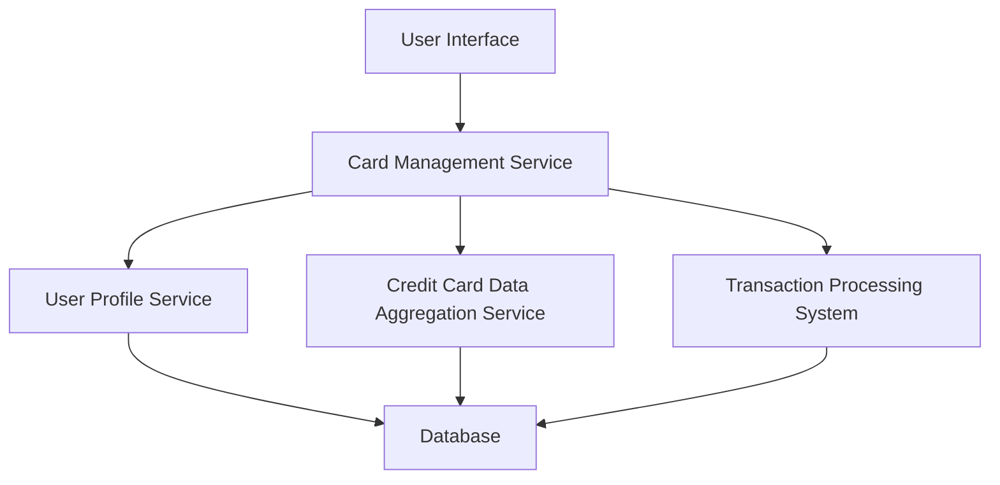

#### 1. High-Level Design

- **Summary:** This epic enables users to manage and monitor multiple credit cards from a single unified interface. The system will display all user-owned credit cards with individual card details, perform card-wise spend analysis, track spending trends, and provide card comparison capabilities to optimize credit card usage across a portfolio of up to 10 cards per user.

- **Component Flow:**

- **Integration Points:**
  - **Upstream:** User Profile Service (for card ownership validation), Credit Card Data Aggregation Service (for retrieving card details and balances), Transaction Processing System (for transaction history and spend analysis)
  - **Downstream:** User Interface layer for rendering card portfolio views and analytics

- **Key Assumptions:**
  - Card data is provided in a standardized JSON format by the Credit Card Data Aggregation Service
  - Transaction data is categorized and timestamped at the source system level

- **NFR Highlights:** System must support at least 10 credit cards per user; Card data retrieval must complete within 3 seconds; Interface must maintain responsive design across desktop, tablet, and mobile devices

- **Data Flow:** User authenticates and requests card portfolio view → Card Management Service validates user identity via User Profile Service → Service retrieves card details from Credit Card Data Aggregation Service and transaction data from Transaction Processing System → Data is aggregated, processed, and formatted → Card-wise spend analysis and trends are calculated → Consolidated view is rendered on the User Interface with individual card details, comparison metrics, and monthly spend trends.

#### 2. Validation Report

- **Requirements Coverage:** The design fully covers the epic's stated scope including multiple credit card display, card-wise spend analysis, individual card details view, card comparison capabilities, and monthly spend trends per card. All NFRs (10 cards per user, 3-second retrieval, responsive design) are addressed through the architecture. Dependencies on credit card data aggregation service, user profile service, and transaction processing system are explicitly integrated into the component flow.