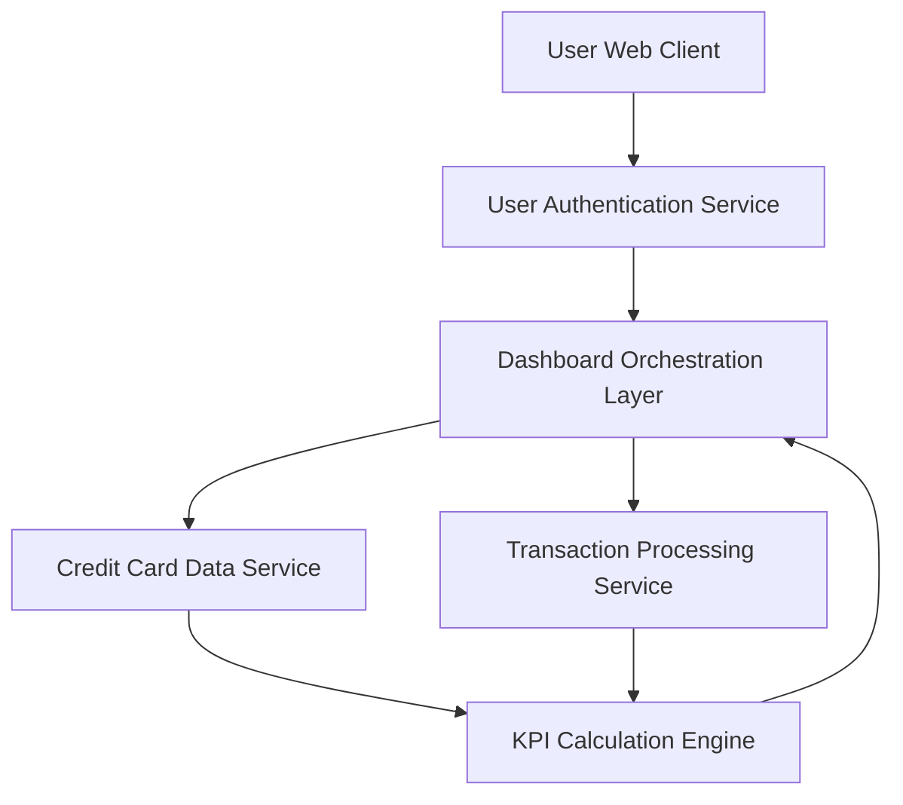

#### 1. High-Level Design

- **Summary**: This epic delivers a comprehensive dashboard providing a consolidated view of all credit cards and key financial metrics. Users can monitor critical KPIs including monthly spend, total credit limit, available credit, and outstanding amounts across all cards in a unified interface with real-time visibility into credit utilization and financial health.

- **Component Flow**:

- **Integration Points**: 
  - **Upstream**: User authentication service (provides secure access control), Credit card data service (retrieves card information), Transaction processing service (calculates spending metrics)
  - **Downstream**: Dashboard Orchestration Layer (aggregates data from multiple services), KPI Calculation Engine (computes financial metrics)

- **Key Assumptions**: 
  - Real-time data refresh is achieved through periodic polling or event-driven updates (mechanism not specified).
  - Credit utilization is calculated as (Outstanding Amount / Total Credit Limit) × 100 across all cards.

- **NFR Highlights**: Dashboard must load within 2 seconds; system must support real-time data refresh; responsive design must support mobile and desktop viewports; data accuracy must be maintained at 99.9%.

- **Data Flow**: User authenticates via User Authentication Service → Dashboard Orchestration Layer requests data from Credit Card Data Service (card details, limits) and Transaction Processing Service (transaction history, spending data) → KPI Calculation Engine computes aggregated metrics (monthly spend, total credit limit, available credit, outstanding amounts, credit utilization) → Dashboard Orchestration Layer consolidates KPIs and card portfolio data → Responsive UI renders consolidated dashboard view with real-time metrics → User monitors financial health and credit utilization across all cards in unified interface.

#### 2. Validation Report

- **Requirements Coverage**: The design fully addresses all scope elements including dashboard KPIs display, monthly spend tracking, total credit limit aggregation, available credit calculation, outstanding amount monitoring, multiple credit card view, and responsive layout design. All NFRs are satisfied: 2-second load time through efficient Dashboard Orchestration Layer, real-time data refresh via integration with Credit Card Data Service and Transaction Processing Service, responsive design for mobile and desktop viewports, and 99.9% data accuracy through robust KPI Calculation Engine. All stated dependencies (Credit card data service, Transaction processing service, User authentication service) are properly integrated into the architecture.