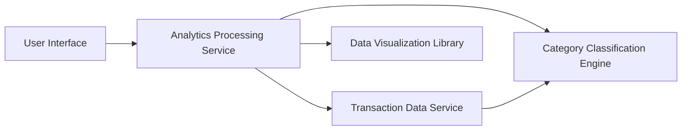

#### 1. High-Level Design

- **Summary**: This epic delivers interactive visualization and analytics capabilities for understanding spending behavior through category-wise analysis and monthly spend trends. Users can explore transaction breakdowns across nine predefined categories with trend analysis over time to identify spending patterns and financial optimization opportunities.

- **Component Flow**:

- **Integration Points**: 
  - **Upstream**: Transaction data service (source of raw transaction records), Category classification engine (provides transaction categorization logic)
  - **Downstream**: Data visualization library (renders charts and graphs), Analytics processing service (aggregates and processes data for insights)

- **Key Assumptions**: 
  - Transactions are pre-categorized by the Category Classification Engine using predefined rules; manual recategorization is not supported.
  - Historical data beyond 12 months is archived and not available for real-time analysis.

- **NFR Highlights**: Analytics visualizations must render within 3 seconds; system must support analysis of minimum 12 months of historical data; charts must be interactive with drill-down capabilities; data aggregation must handle minimum 1000 transactions per month.

- **Data Flow**: User selects analytics view → Analytics Processing Service queries Transaction Data Service for historical transaction data → Category Classification Engine categorizes transactions into 9 predefined categories (Food & Dining, Fuel, Shopping, Travel, Entertainment, Utilities, Healthcare, Education, Miscellaneous) → Aggregated data is processed for monthly trends and category-wise spending → Data Visualization Library renders interactive charts and graphs → User interacts with visualizations for drill-down analysis and pattern identification.

#### 2. Validation Report

- **Requirements Coverage**: The design comprehensively covers all stated scope elements including category-wise spending visualization, monthly spend trend analysis, interactive charts and graphs, transaction categorization across 9 categories, spending pattern identification, and historical trend comparison. All NFRs are addressed: 3-second rendering time through optimized data aggregation, 12-month historical data support via Transaction Data Service, interactive drill-down capabilities through Data Visualization Library, and capacity to handle 1000+ transactions per month through the Analytics Processing Service architecture.