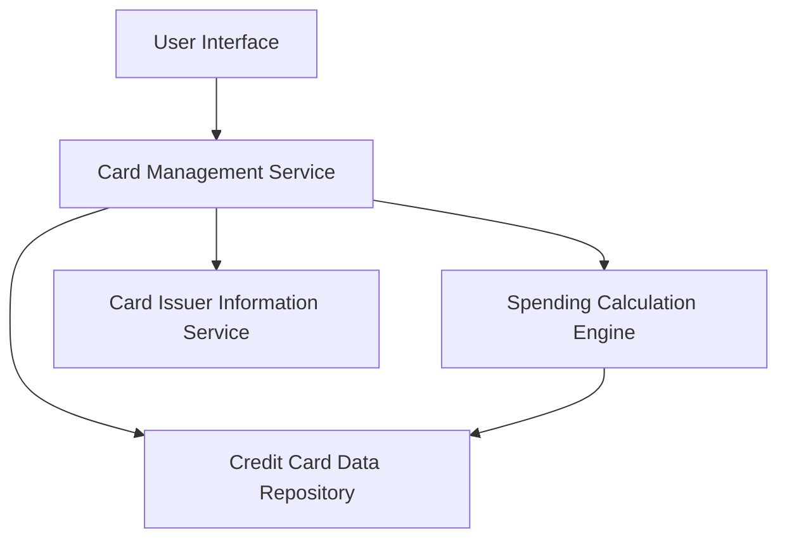

#### 1. High-Level Design

- **Summary**: This epic enables users to view and manage multiple credit cards with detailed card-wise spending analysis. The system provides individual card details, spending pattern comparison, and card-level analytics to help users optimize their credit card portfolio and make strategic usage decisions.

- **Component Flow**:

- **Integration Points**: 
  - **Upstream**: Credit card data repository (source of card master data), Card issuer information service (provides issuer-specific details)
  - **Downstream**: Spending calculation engine (consumes transaction data to compute card-wise analytics)

- **Key Assumptions**: 
  - Card data is pre-loaded and synchronized from an external source on a scheduled basis (frequency not specified).
  - Card comparison logic uses standardized metrics across all card types regardless of issuer-specific variations.

- **NFR Highlights**: System must support minimum 10 credit cards per user; card data retrieval must complete within 1 second; UI must handle dynamic card additions without performance degradation.

- **Data Flow**: User requests card portfolio view → Card Management Service retrieves card details from Credit Card Data Repository → Spending Calculation Engine processes transaction data to compute card-wise spending metrics → Card Issuer Information Service enriches data with issuer details → Aggregated card-wise analytics and details are rendered in the UI for comparison and analysis.

#### 2. Validation Report

- **Requirements Coverage**: The design fully covers the epic's stated scope including multiple credit card display, card-wise spend analysis, individual card details view, card comparison capabilities, and card-level credit utilization tracking. All NFRs related to performance (1-second retrieval), scalability (10+ cards per user), and UI responsiveness are addressed through the component architecture. The integration dependencies (Credit card data repository, Card issuer information service, Spending calculation engine) are properly mapped to system components.