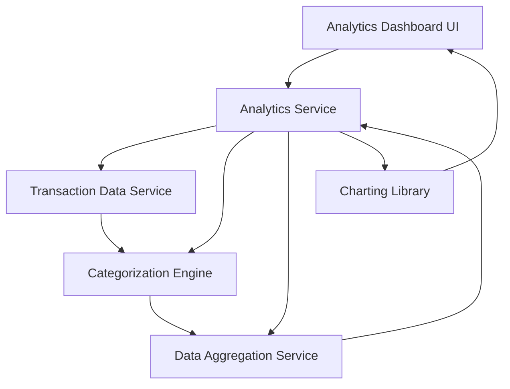

#### 1. High-Level Design

- **Summary:** This epic provides interactive visualizations and analytical capabilities for understanding spending behavior through category-wise analysis (Food & Dining, Fuel, Shopping, Travel, Entertainment, Utilities, Healthcare, Education, Miscellaneous) and monthly spend trends over 12 months, enabling data-driven financial decisions.

- **Component Flow:**

- **Integration Points:**
  - **Upstream:** Transaction Data Service (for retrieving 12 months of transaction history)
  - **Downstream:** Categorization Engine (for classifying transactions into predefined categories), Data Aggregation Service (for trend calculations), Charting Library (for visualization rendering)

- **Key Assumptions:**
  - Transactions will be auto-categorized using merchant codes (MCC) and merchant names with 95% accuracy; users can manually recategorize if needed.
  - Monthly trend data will be aggregated at month-end and cached for performance, with incremental updates for the current month.

- **NFR Highlights:** Analytics visualizations must render within 1.5 seconds, support interactive filtering and drill-down, handle 12 months of transaction history, ensure 95% transaction categorization accuracy.

- **Data Flow:** User accesses analytics dashboard → Analytics Service retrieves transaction history (12 months) from Transaction Data Service → Categorization Engine classifies transactions into 9 predefined categories using MCC codes and merchant data → Data Aggregation Service calculates category-wise spending totals and monthly trends → Analytics Service formats data for visualization → Charting Library renders interactive charts (category breakdown, monthly trends) within 1.5 seconds → User interacts with filters and drill-down options → Analytics Service re-aggregates and updates visualizations in real-time.

#### 2. Validation Report

- **Requirements Coverage:** The design fully addresses all scope requirements: category-wise spending visualization, monthly spend trend charts, interactive analytics dashboard, transaction categorization, spending pattern analysis, category breakdown display, trend comparison across months, and visual chart rendering. All NFRs are supported (1.5-second rendering via data caching and optimized aggregation, interactive filtering and drill-down capabilities, 12-month transaction history handling, 95% categorization accuracy through MCC-based engine). All dependencies are integrated (transaction data service, categorization engine, charting library, data aggregation service). Out-of-scope items (real bank integration, predictive analytics, budget recommendations, automated savings, payment gateway, third-party integrations) are appropriately excluded from the design.