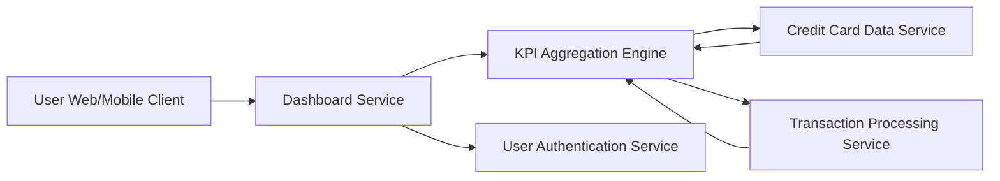

#### 1. High-Level Design

- **Summary:** This epic delivers a comprehensive dashboard displaying key performance indicators (KPIs) for credit card management, including monthly spend, total credit limit, available credit, and outstanding amounts. It serves as the primary landing interface providing a consolidated financial snapshot.

- **Component Flow:**

- **Integration Points:**
  - **Upstream:** User Authentication Service (for secure access control)
  - **Downstream:** Credit Card Data Service (for card balances and limits), Transaction Processing Service (for monthly spend calculations)

- **Key Assumptions:**
  - KPI metrics will be calculated in near real-time with a refresh interval of 30-60 seconds for balance updates.
  - Monthly spend is calculated based on the current calendar month (1st to last day) unless user preferences specify a custom billing cycle.

- **NFR Highlights:** Dashboard must load within 2 seconds, support responsive design (desktop and mobile), handle real-time data refresh for KPIs, ensure data accuracy for financial calculations.

- **Data Flow:** User accesses dashboard → Authentication Service validates user session → Dashboard Service requests KPI data from Aggregation Engine → Aggregation Engine fetches card balances/limits from Credit Card Data Service and monthly transactions from Transaction Processing Service → Calculates total credit limit, available credit, outstanding amounts, and monthly spend → Returns aggregated KPIs to Dashboard Service → Dashboard renders responsive UI with KPIs within 2 seconds → Real-time refresh updates metrics periodically.

#### 2. Validation Report

- **Requirements Coverage:** The design comprehensively addresses all scope elements: monthly spend display, total credit limit calculation, available credit tracking, outstanding amount visualization, dashboard layout design, responsive UI implementation, and KPI data aggregation. All NFRs are supported (2-second load time via caching and optimized queries, responsive design across devices, real-time refresh capability, financial calculation accuracy through dedicated aggregation engine). All dependencies are integrated (credit card data service, transaction processing service, user authentication service). Out-of-scope items (real bank integration, payments, fund transfers, payment gateway, loans) are correctly excluded.