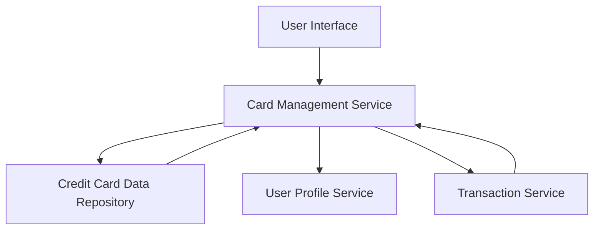

#### 1. High-Level Design

- **Summary:** This epic enables users to manage and monitor multiple credit cards (up to 20) from a unified interface. It provides card-specific details, card-wise spend analysis, and consolidated portfolio views, eliminating the need for multiple banking apps.

- **Component Flow:**

- **Integration Points:**
  - **Upstream:** User Profile Service (for user authentication and card-user linking)
  - **Downstream:** Credit Card Data Repository (for card information storage and retrieval), Transaction Service (for card-specific spending data)

- **Key Assumptions:**
  - Card data will be stored in a structured format (JSON/relational) with standardized fields for card number, issuer, limits, and balances.
  - Card masking will follow PCI-DSS standards, displaying only the last 4 digits of card numbers.

- **NFR Highlights:** System must support up to 20 credit cards per user, card data retrieval within 3 seconds, secure storage with appropriate card number masking (PCI-DSS compliance implied).

- **Data Flow:** User requests card portfolio view → Card Management Service authenticates user via User Profile Service → Retrieves card details from Credit Card Data Repository → Fetches card-specific spending from Transaction Service → Aggregates and masks sensitive data → Returns consolidated and individual card views to UI → User can navigate between cards and view card-wise analysis.

#### 2. Validation Report

- **Requirements Coverage:** The design fully covers the epic's stated scope including multiple credit card display, card-wise spend analysis, individual card details view, card listing interface, card selection and navigation, card-specific balance tracking, and consolidated card overview. The architecture supports all NFRs (20 cards per user, 3-second retrieval, secure storage with masking) and integrates with all specified dependencies (credit card data repository, user profile service, transaction service). Out-of-scope items (real bank integration, payments, fund transfers, payment gateway, loans, card application) are appropriately excluded from the design.