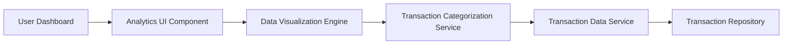

#### 1. High-Level Design

**Summary:**  
This epic provides comprehensive spending analytics through interactive visualizations to help users understand spending patterns. Users can analyze expenses by nine categories (Food & Dining, Fuel, Shopping, Travel, Entertainment, Utilities, Healthcare, Education, Miscellaneous), view monthly spend trends, and perform card-wise spend analysis for data-driven financial decisions.

**Component Flow:**

**Integration Points:**
- **Upstream:** Transaction data service or repository for retrieving transaction history
- **Downstream:** Data visualization library integration for rendering charts; transaction categorization engine or service for assigning categories to transactions

**Key Assumptions:**
- Transactions are pre-categorized or categorization logic is provided by an external service. Visualization library supports interactive, responsive charts compatible with target devices.

**NFR Highlights:**  
Visualizations must render within 3 seconds; charts must be interactive and responsive across devices; system must handle minimum 1000 transactions per card for analysis; category calculations must be accurate to 2 decimal places.

#### 2. Validation Report

**Requirements Coverage:**  
The design comprehensively covers the epic's scope including category-wise spending visualization, monthly spend trend charts, card-wise spend analysis, interactive charts and graphs, nine spending categories tracking, spending pattern identification, and transaction categorization display. All NFRs are addressed: 3-second render time, interactive and responsive charts, 1000+ transaction handling capacity, and 2-decimal-place accuracy for calculations.