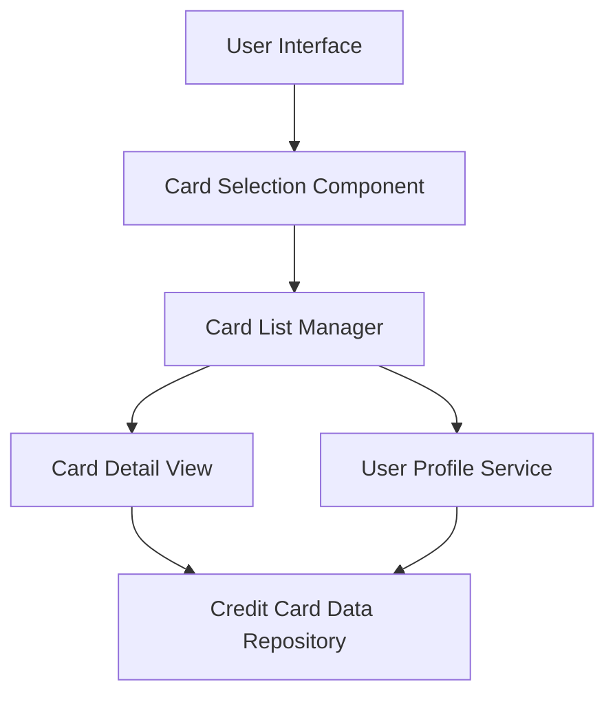

#### 1. High-Level Design

**Summary:**  
This epic enables users to view and manage multiple credit cards within the dashboard interface. Users can see all registered credit cards with individual details, switch between cards to view card-specific information, and monitor each card's status independently. The feature provides a comprehensive portfolio view for easy comparison and management.

**Component Flow:**

**Integration Points:**
- **Upstream:** User profile service to link cards to user accounts and manage card ownership
- **Downstream:** Credit card data repository or service for retrieving individual card details and metrics

**Key Assumptions:**
- Each card has a unique identifier for switching and data isolation. Card data ownership is managed through user profile service with proper authorization checks.

**NFR Highlights:**  
System must support minimum 10 credit cards per user; card switching must occur within 500ms; UI must clearly distinguish between different cards; data isolation must ensure card information is displayed accurately per card.

#### 2. Validation Report

**Requirements Coverage:**  
The design fully covers the epic's scope including multiple credit card display, card listing interface, card selection and switching functionality, individual card detail views, card-specific metrics display, and card identification and labeling. All NFRs are addressed: support for 10+ cards, 500ms switching performance, clear UI distinction, and data isolation for accuracy.