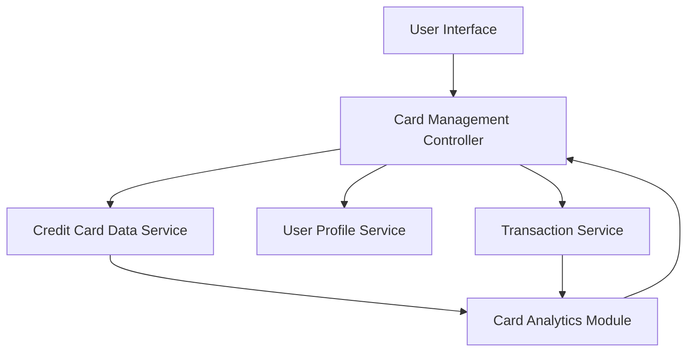

#### 1. High-Level Design

- **Summary:** This epic enables users to manage and monitor multiple credit cards from a unified interface. The core requirement is to provide a consolidated view of all credit cards with card-specific details (limits, balances, utilization), support seamless card switching, and deliver card-wise spend analysis to help users track their entire credit card portfolio efficiently.

- **Component Flow:**

- **Integration Points:**
  - **Upstream:** Credit Card Data Service (for card details, limits, and balances)
  - **Upstream:** User Profile Service (for associating cards with user accounts)
  - **Upstream:** Transaction Service (for card-wise spending data and monthly trends)
  - **Downstream:** User Interface (for multi-card display and card selection interface)

- **Key Assumptions:**
  - Card data is stored with user associations in the User Profile Service, enabling efficient retrieval of all cards for a given user.
  - Card-wise spend analysis is calculated on-demand or cached with periodic refresh to meet the 1.5-second retrieval requirement.

- **NFR Highlights:** System must support minimum 10 credit cards per user; card data retrieval must complete within 1.5 seconds; interface must maintain performance with up to 50 cards displayed.

- **Data Flow:** User accesses the multi-card management interface through the UI, which triggers the Card Management Controller to fetch user-associated cards from the User Profile Service. The controller retrieves detailed card information (limits, balances) from the Credit Card Data Service and card-wise spending data from the Transaction Service. The Card Analytics Module aggregates and calculates card-specific metrics including utilization, monthly spend trends, and balances. All card data is consolidated and returned to the UI, where users can view all cards, switch between them, and access card-specific spend analysis.

#### 2. Validation Report

- **Requirements Coverage:** The design fully addresses the epic's scope including multiple credit card display, card-wise spend analysis, individual card limit tracking, card-specific balance monitoring, card selection and switching interface, and monthly spend trends per card. The architecture supports all NFRs through efficient data retrieval patterns (1.5-second retrieval), scalable card storage (minimum 10, up to 50 cards), and optimized UI rendering. All dependencies on Credit Card Data Service, User Profile Service, and Transaction Service are explicitly integrated and the data flow ensures seamless multi-card management capabilities.