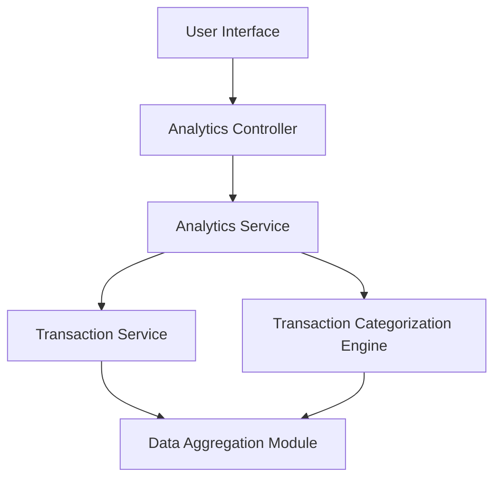

#### 1. High-Level Design

- **Summary:** This epic provides interactive visualizations and analytics to help users understand spending behavior across nine predefined categories (Food & Dining, Fuel, Shopping, Travel, Entertainment, Utilities, Healthcare, Education, Miscellaneous). The core requirement is to deliver category-wise spending breakdowns with visual representations, enabling trend analysis and data-driven financial decisions.

- **Component Flow:**

- **Integration Points:**
  - **Upstream:** Transaction Service (for raw transaction data)
  - **Upstream:** Transaction Categorization Engine (for automatic category assignment to transactions)
  - **Upstream:** Analytics Service (for data aggregation and visualization rendering)
  - **Downstream:** User Interface (for interactive charts, graphs, and drill-down capabilities)

- **Key Assumptions:**
  - Transaction categorization is performed automatically by the Categorization Engine using predefined rules or ML models.
  - Analytics data is pre-aggregated on a scheduled basis (e.g., hourly) to meet the 1-second visualization render time requirement.

- **NFR Highlights:** Analytics visualizations must render within 1 second; system must process and categorize up to 10,000 transactions per user per month; charts must be interactive and support drill-down capabilities.

- **Data Flow:** User requests spending analytics through the UI, triggering the Analytics Controller to fetch data from the Analytics Service. The Analytics Service retrieves raw transaction data from the Transaction Service and category assignments from the Transaction Categorization Engine. The Data Aggregation Module processes and aggregates transactions by category, calculating percentages and amounts. The aggregated data is returned to the UI where interactive visualizations (charts and graphs) are rendered, allowing users to drill down into specific categories and time periods.

#### 2. Validation Report

- **Requirements Coverage:** The design comprehensively covers the epic's scope including category-wise spending visualization, interactive charts and graphs, spending pattern analysis, nine predefined spending categories, monthly spend trend analysis, and category breakdown by percentage and amount. The architecture addresses all NFRs through pre-aggregation strategies (1-second render time), scalable transaction processing (10,000 transactions/user/month), and interactive visualization components. All dependencies on Transaction Service, Transaction Categorization Engine, and Analytics Service are explicitly integrated into the component flow.