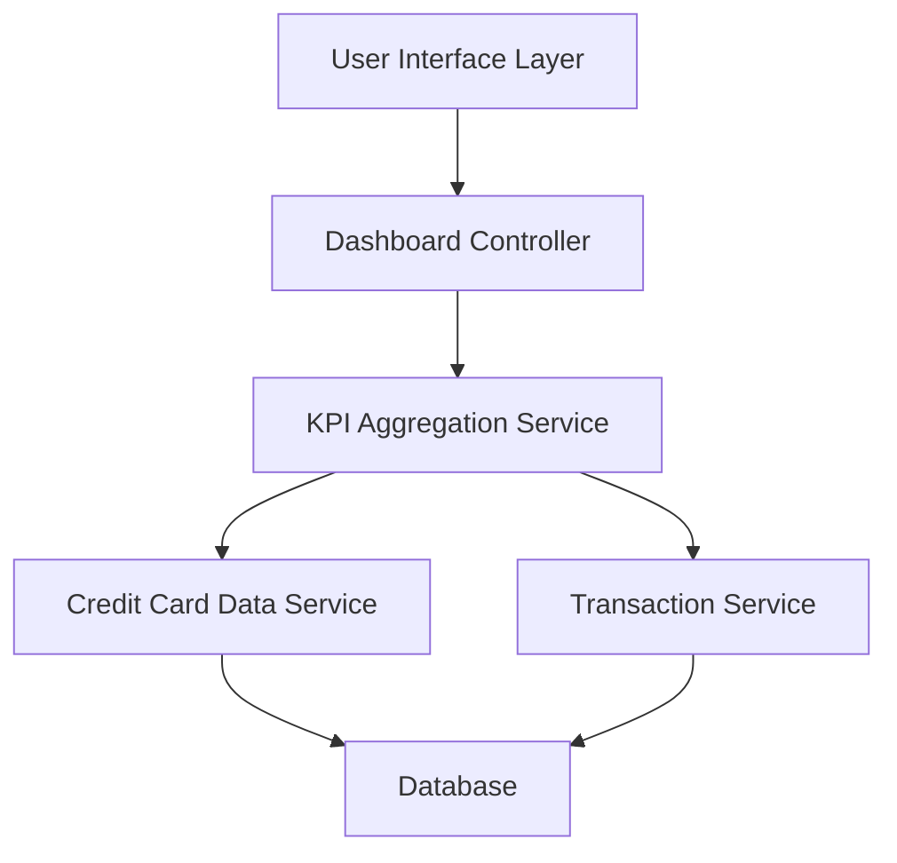

#### 1. High-Level Design

- **Summary:** This epic delivers a centralized dashboard that aggregates and displays key performance indicators (KPIs) for a user's credit card portfolio. The core requirement is to provide real-time visibility into monthly spend, total credit limit, available credit, and outstanding amounts through a responsive interface accessible across mobile, tablet, and desktop devices.

- **Component Flow:**

- **Integration Points:**
  - **Upstream:** Credit Card Data Service (for card balances, limits, and outstanding amounts)
  - **Upstream:** Transaction Service (for monthly spend calculations and aggregations)
  - **Downstream:** User Interface Layer (responsive dashboard rendering)

- **Key Assumptions:**
  - Data refresh frequency is assumed to be near real-time (within 30 seconds of transaction posting).
  - KPI calculations are performed server-side with cached results to meet the 2-second load time requirement.

- **NFR Highlights:** Dashboard must load within 2 seconds; must support responsive design for mobile, tablet, and desktop; must handle real-time data refresh for KPI metrics.

- **Data Flow:** User accesses the dashboard through the UI layer, which triggers the Dashboard Controller to request aggregated KPI data. The KPI Aggregation Service fetches card balances and limits from the Credit Card Data Service and monthly spend data from the Transaction Service. Both services query the Database for raw data. The aggregated KPIs (monthly spend, total credit limit, available credit, outstanding amounts) are calculated and returned to the UI for display in a consolidated view.

#### 2. Validation Report

- **Requirements Coverage:** The design fully covers the epic's stated scope including monthly spend display, total credit limit calculation, available credit tracking, outstanding amount monitoring, consolidated KPI view, and responsive dashboard layout. The architecture supports all specified NFRs (2-second load time, responsive design, real-time refresh) through service-oriented design with caching and aggregation layers. All dependencies on Credit Card Data Service and Transaction Service are explicitly addressed in the component flow.