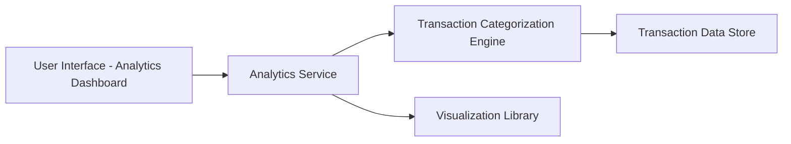

#### 1. High-Level Design

- **Summary:** This epic provides interactive visualizations for analyzing spending patterns across nine predefined expense categories (Food & Dining, Fuel, Shopping, Travel, Entertainment, Utilities, Healthcare, Education, and Miscellaneous). The core requirement is to enable users to view detailed spending breakdowns and gain actionable insights into their spending behavior for budget optimization.

- **Component Flow:**

- **Integration Points:** 
  - Upstream: Transaction data source with category information
  - Internal: Visualization library for interactive charts (e.g., Chart.js, D3.js, or similar)
  - Internal: Transaction categorization engine for automatic category assignment

- **Key Assumptions:** 
  - Transactions are pre-categorized or can be automatically categorized into the nine predefined categories using merchant codes or transaction descriptions
  - The visualization library supports interactive features such as filtering, drill-down, and responsive rendering

- **NFR Highlights:** Visualizations must load within acceptable time limits; Interactive charts must be responsive and support user interactions such as filtering and drill-down; System must accurately categorize transactions into predefined categories

- **Data Flow:** User accesses the analytics dashboard, which sends requests to the Analytics Service. The service retrieves transaction data from the Transaction Data Store and passes it through the Transaction Categorization Engine to ensure all transactions are assigned to one of the nine predefined categories. The categorized data is then aggregated by category and passed to the Visualization Library, which generates interactive charts and graphs. The rendered visualizations are displayed in the UI, allowing users to interact with the data through filtering and drill-down capabilities.

#### 2. Validation Report

- **Requirements Coverage:** The design comprehensively covers the epic's scope including category-wise spending visualization, interactive charts and graphs, spending pattern analysis across all nine categories (Food & Dining, Fuel, Shopping, Travel, Entertainment, Utilities, Healthcare, Education, and Miscellaneous), and transaction categorization. All NFRs are addressed: visualization load time through efficient data aggregation, interactive responsiveness through a dedicated visualization library, and accurate categorization through a specialized categorization engine. The design excludes out-of-scope items (real bank integration, payments, fund transfers, loans, payment gateway integration, custom category creation) as specified.