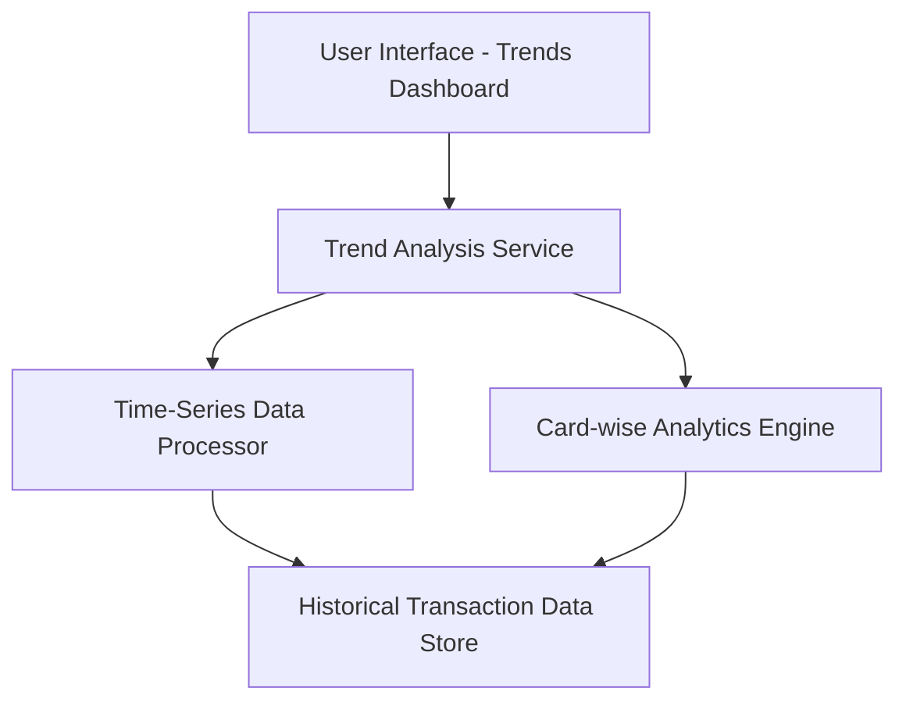

#### 1. High-Level Design

- **Summary:** This epic enables users to track spending patterns over time through monthly spend trend analysis and compare performance across individual credit cards. The core requirement is to provide historical spending visibility, identify seasonal patterns, and enable card-wise spending comparison to optimize card usage based on benefits, rewards, and spending patterns.

- **Component Flow:**

- **Integration Points:** 
  - Upstream: Historical transaction data repository with time-series capabilities
  - Internal: Time-series data processing engine for trend calculations
  - Internal: Card-specific transaction records for card-wise analysis
  - Internal: Date-range filtering functionality for multi-period comparison

- **Key Assumptions:** 
  - Historical transaction data is available with sufficient history to identify meaningful trends and seasonal patterns (minimum 6-12 months assumed)
  - Each transaction record includes card identifier and timestamp for accurate card-wise and time-based aggregation

- **NFR Highlights:** System must efficiently handle and display historical transaction data; Trend calculations must be accurate and consistent; Performance must remain optimal when displaying data across multiple time periods and cards

- **Data Flow:** User accesses the trends dashboard and selects date ranges or specific cards for analysis. The UI sends requests to the Trend Analysis Service, which coordinates between the Time-Series Data Processor and Card-wise Analytics Engine. The Time-Series Data Processor retrieves historical transaction data from the data store, aggregates spending by month, and calculates trends and patterns. The Card-wise Analytics Engine retrieves card-specific transaction records and performs comparative analysis across cards. Both processed datasets are returned to the UI, where they are visualized as trend lines, comparative charts, and card performance metrics, enabling users to identify spending patterns and optimize card usage.

#### 2. Validation Report

- **Requirements Coverage:** The design fully addresses the epic's scope including monthly spend trend visualization, historical spending data display, card-wise spend comparison, individual card performance analysis, trend identification, and multi-period comparison. All NFRs are satisfied: efficient handling of historical data through a dedicated time-series processor, accurate and consistent trend calculations through specialized analytics engines, and optimal performance across multiple time periods and cards through efficient data aggregation and caching strategies. The design explicitly excludes out-of-scope items (real bank integration, payments, fund transfers, loans, payment gateway integration, predictive spending forecasts) as specified.