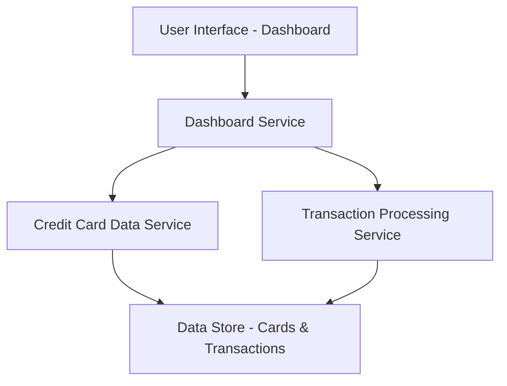

#### 1. High-Level Design

- **Summary:** This epic delivers a consolidated dashboard that displays key performance indicators (KPIs) for the user's credit card portfolio. The core requirement is to provide real-time visibility into monthly spend, total credit limit, available credit, and outstanding amounts across all credit cards through a responsive interface that works on desktop, tablet, and mobile devices.

- **Component Flow:**

- **Integration Points:** 
  - Upstream: Credit card data source for card details and credit limit information
  - Upstream: Transaction history system for spend calculations
  - Downstream: Responsive UI framework for multi-device rendering

- **Key Assumptions:** 
  - Credit card data is available in a structured format with fields for credit limit, current balance, and card identifiers
  - Transaction data is timestamped and linked to specific credit cards for accurate monthly spend calculation

- **NFR Highlights:** Dashboard must be responsive across desktop, tablet, and mobile devices; KPI calculations must be accurate and update in real-time; System must support viewing multiple credit cards simultaneously without performance degradation

- **Data Flow:** User accesses the dashboard through the UI, which sends requests to the Dashboard Service. The Dashboard Service queries the Credit Card Data Service for card details (credit limits, outstanding amounts) and the Transaction Processing Service for monthly spend calculations. Both services retrieve data from the centralized Data Store. The aggregated KPIs (monthly spend, total credit limit, available credit, outstanding amounts) are calculated and returned to the UI for display in a consolidated, multi-card view.

#### 2. Validation Report

- **Requirements Coverage:** The design fully covers the epic's stated scope including monthly spend display, total credit limit calculation, available credit tracking, outstanding amount monitoring, multi-card consolidated view, and responsive dashboard layout. All NFRs regarding responsiveness, accuracy, real-time updates, and multi-card performance are addressed through the service-oriented architecture with dedicated data services and a responsive UI layer. The design explicitly excludes out-of-scope items (real bank integration, payments, fund transfers, loans, payment gateway integration) as specified.