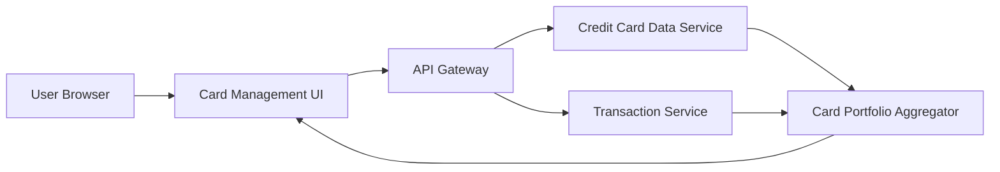

#### 1. High-Level Design

- **Summary:** This epic enables users to manage and monitor multiple credit cards (minimum 10 per user) from a unified interface. Users can view all cards, access individual card details (credit limits, balances), perform card-wise spend analysis, track utilization, and apply card selection/filtering. The feature consolidates card portfolio management into a single view for optimized usage planning.

- **Component Flow:**

- **Integration Points:** 
  - **Upstream:** Credit card data service (card information and metadata), Transaction service (card-specific spending data)
  - **Downstream:** Unified card portfolio view with filtering and selection capabilities rendered to end users

- **Key Assumptions:** 
  - Card metadata (issuer, card type, benefits) is maintained in the credit card data service and retrieved along with balance/limit data
  - Card-wise spend analysis aggregates transactions by card identifier; assumes transaction data includes card reference

- **NFR Highlights:** Support minimum 10 cards per user; card data retrieval ≤ 1 second; efficient dynamic card list rendering in UI

#### 2. Validation Report

- **Requirements Coverage:** The design fully covers the epic scope including multiple credit card display, individual card details view, card-wise spend analysis, utilization tracking, and card selection/filtering. All NFRs are addressed through architectural decisions (Card Portfolio Aggregator for handling 10+ cards, API Gateway for sub-1-second retrieval, dynamic UI rendering for efficient list handling). The design appropriately excludes out-of-scope items (bank integration, card activation, payment processing, applications, rewards).