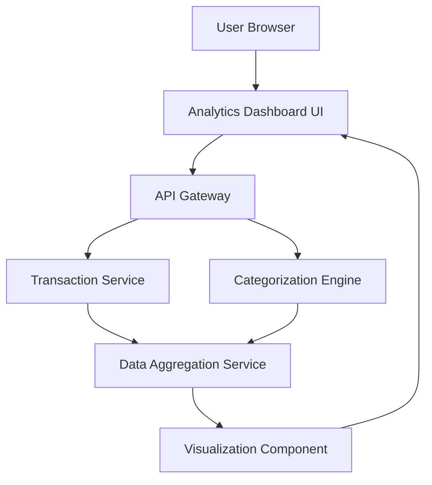

#### 1. High-Level Design

- **Summary:** This epic provides interactive analytics and visualizations for spending pattern analysis across nine predefined categories (Food & Dining, Fuel, Shopping, Travel, Entertainment, Utilities, Healthcare, Education, Miscellaneous). Users can view category-wise breakdowns, monthly trends, and drill down into specific spending categories to optimize expenses.

- **Component Flow:**

- **Integration Points:** 
  - **Upstream:** Transaction service (detailed transaction data), Categorization engine (transaction classification), Data aggregation service (trend calculations)
  - **Downstream:** Interactive charts and visualizations rendered to end users with drill-down capabilities

- **Key Assumptions:** 
  - Transaction categorization is automated by the categorization engine using predefined rules or ML models (manual recategorization is out of scope)
  - Monthly trend calculations aggregate data on a rolling 30-day window or calendar month basis (not specified)

- **NFR Highlights:** Chart rendering ≤ 1.5 seconds; support minimum 1000 transactions/month/user; interactive drill-down capabilities; category calculations accurate to 2 decimal places

#### 2. Validation Report

- **Requirements Coverage:** The design comprehensively addresses all scope items including category-wise visualization, monthly trend charts, interactive analytics dashboard, nine spending categories tracking, spend pattern analysis, and visual data representation. The architecture supports all NFRs through dedicated components (Data Aggregation Service for handling 1000+ transactions, Visualization Component for interactive drill-down, server-side calculations for 2-decimal accuracy).