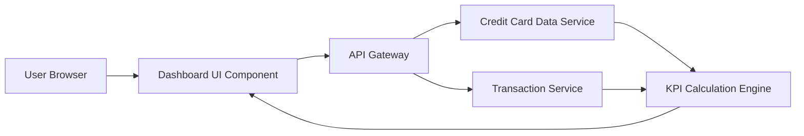

#### 1. High-Level Design

- **Summary:** This epic delivers a consolidated dashboard interface that displays critical financial KPIs including monthly spending, total credit limit across all cards, available credit, and outstanding amounts. The dashboard provides real-time visibility into financial health and credit utilization through a responsive single-pane view.

- **Component Flow:**

- **Integration Points:** 
  - **Upstream:** Credit card data service (for card balances and limits), Transaction service (for monthly spend and outstanding amounts)
  - **Downstream:** Dashboard UI renders aggregated KPI data to end users

- **Key Assumptions:** 
  - Real-time data refresh implies periodic polling or event-driven updates from backend services (frequency not specified, assume 30-60 second intervals)
  - Financial calculations are performed server-side to ensure 100% accuracy; client-side rendering is display-only

- **NFR Highlights:** Dashboard load time ≤ 2 seconds; real-time data refresh; responsive design (desktop/tablet/mobile); 100% data accuracy for financial calculations

#### 2. Validation Report

- **Requirements Coverage:** The design fully covers the epic's stated scope including monthly spend display, credit limit aggregation, available credit calculation, outstanding amount tracking, responsive layout, and KPI visualization. All NFRs (load time, real-time refresh, responsive design, data accuracy) are addressed through appropriate architectural components (API Gateway for performance, KPI Calculation Engine for accuracy, responsive UI framework).