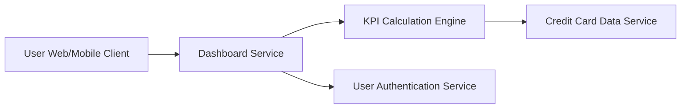

#### 1. High-Level Design

- **Summary:** This epic provides a centralized dashboard displaying critical financial KPIs for the user's credit card portfolio. Key metrics include monthly spend, total credit limit across all cards, available credit, and outstanding amounts. The dashboard offers a real-time snapshot of credit card financial health with a modern, responsive interface accessible across devices.

- **Component Flow:**

- **Integration Points:**
  - **Upstream:** Credit Card Data Service (provides card balances and transaction data), User Authentication Service (secures access)
  - **Downstream:** KPI Calculation Engine (aggregates financial metrics in real-time)
  - **Frontend:** Responsive UI framework supporting mobile and desktop devices

- **Key Assumptions:**
  - "Real-time" data refresh means data is current within 5 minutes; sub-second synchronization with external systems is not required.
  - Available credit is calculated as (Total Credit Limit - Outstanding Amount); pending authorizations are not factored into available credit.

- **NFR Highlights:** Dashboard must load within 2 seconds, support responsive design for mobile and desktop devices, handle real-time data refresh, ensure data accuracy for financial calculations.

- **Data Flow:** User accesses dashboard via web or mobile client → User Authentication Service validates credentials → Dashboard Service requests current financial data → KPI Calculation Engine retrieves card balances and transactions from Credit Card Data Service → Engine calculates aggregated KPIs (monthly spend, total limit, available credit, outstanding) → Dashboard Service formats and returns KPIs to client → UI renders responsive dashboard with visualization components → Dashboard auto-refreshes periodically to maintain real-time view.

#### 2. Validation Report

- **Requirements Coverage:** The design fully addresses the epic's scope including monthly spend display, total credit limit aggregation, available credit calculation, outstanding amount tracking, responsive dashboard layout, and KPI visualization components. All NFRs are met: 2-second load time through optimized data retrieval and caching, responsive design for cross-device support, real-time refresh capability, and accurate financial calculations via dedicated KPI engine. Out-of-scope items (real bank integration, payment processing, fund transfers) are explicitly excluded.