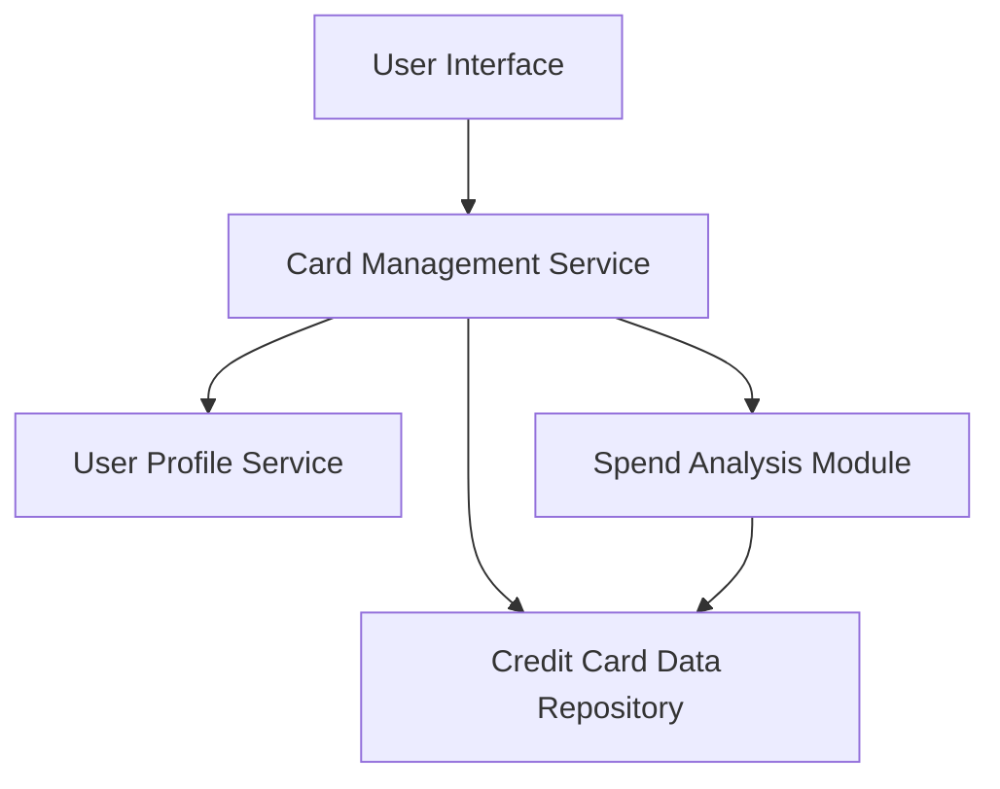

#### 1. High-Level Design

- **Summary:** This epic enables users to manage and monitor multiple credit cards from a unified interface. Users can view all cards in one place, access card-specific details (credit limits, balances, spending patterns), and perform card-wise spend analysis to understand utilization across their card portfolio.

- **Component Flow:**

- **Integration Points:**
  - **Upstream:** Credit Card Data Repository (stores card metadata, balances, and transaction history), User Profile Service (manages card-user associations)
  - **Downstream:** Spend Analysis Module (calculates card-specific spending patterns)
  - **Security:** Secure storage of card metadata with encryption at rest

- **Key Assumptions:**
  - Card metadata (last 4 digits, card type, issuer) is stored securely; full card numbers are not stored in the system.
  - Card-wise spend analysis is calculated daily in batch mode; real-time per-transaction updates are not required.

- **NFR Highlights:** System must support minimum 10 credit cards per user, card data retrieval latency under 500ms, secure storage of card metadata with encryption.

- **Data Flow:** User logs in and requests card portfolio view → Card Management Service authenticates via User Profile Service → Service retrieves all associated cards from Credit Card Data Repository → For each card, Spend Analysis Module calculates spending patterns and utilization → Aggregated card details (limits, balances, spending) are displayed in UI → User can select individual cards to view detailed card-specific analysis.

#### 2. Validation Report

- **Requirements Coverage:** The design comprehensively covers the epic's scope including multiple credit card display, card-wise spend analysis, individual card details view, card selection/filtering, and card-specific balance tracking. All NFRs are addressed: support for 10+ cards per user, sub-500ms retrieval latency through optimized data access patterns, and secure metadata storage. The design explicitly excludes out-of-scope items (real bank integration, payments, card applications).