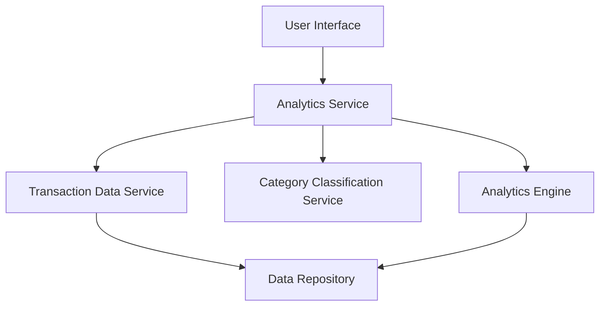

#### 1. High-Level Design

- **Summary:** This epic delivers analytical capabilities for users to visualize and understand spending behavior through interactive charts. It supports category-wise spending analysis across nine predefined categories (Food & Dining, Fuel, Shopping, Travel, Entertainment, Utilities, Healthcare, Education, Miscellaneous) and provides monthly spend trend analysis to enable proactive budget management.

- **Component Flow:**

- **Integration Points:**
  - **Upstream:** Transaction Data Service (provides raw transaction data), Category Classification Service (categorizes transactions)
  - **Downstream:** Analytics Engine (performs data aggregation and trend calculations)
  - **Data Storage:** Data Repository (stores historical transaction data for at least 12 months)

- **Key Assumptions:**
  - Transactions are pre-classified into one of the nine categories by the Category Classification Service; manual reclassification is not in scope.
  - Monthly trends are calculated based on transaction posting date; real-time intra-day trends are not required.

- **NFR Highlights:** Visualizations must render within 1 second, support interactive filtering without page reload, handle historical data for at least 12 months, ensure accurate category classification.

- **Data Flow:** User requests spending insights via the UI → Analytics Service retrieves transaction data from Transaction Data Service → Category Classification Service tags transactions with appropriate categories → Analytics Engine aggregates data by category and time period → Processed insights (charts, trends) are returned to UI → User interacts with visualizations to drill down into specific categories or time periods.

#### 2. Validation Report

- **Requirements Coverage:** The design fully covers the epic's stated scope including category-wise spending visualization, monthly spend trend analysis, interactive charts, support for nine spending categories, and data filtering capabilities. All NFRs regarding rendering performance (1 second), interactive filtering, 12-month historical data, and category classification accuracy are addressed through appropriate service components.