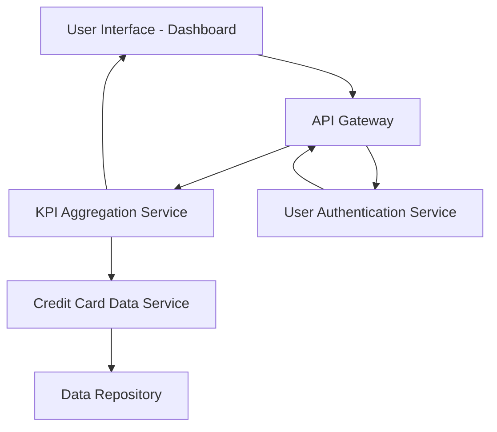

#### 1. High-Level Design

- **Summary:** This epic delivers a consolidated dashboard that displays key performance indicators (KPIs) for the user's credit card portfolio, including monthly spend, total credit limit, available credit, and outstanding amounts. The dashboard provides real-time visibility into overall credit card financial health through a responsive interface accessible on both mobile and desktop devices.

- **Component Flow:**

- **Integration Points:**
  - **Upstream:** User Authentication Service (for secure access control)
  - **Downstream:** Credit Card Data Service (for fetching card balances and transaction data)

- **Key Assumptions:**
  - KPI data is aggregated in near real-time with acceptable latency of up to 2 seconds; data format follows standard JSON structure for API responses.
  - Credit card data is assumed to be pre-validated and stored in a centralized repository accessible via REST APIs.

- **NFR Highlights:** Dashboard must load within 2 seconds, support responsive design for mobile and desktop devices, and handle real-time data refresh for KPI updates.

#### 2. Validation Report

- **Requirements Coverage:** The design fully covers the epic's stated scope including monthly spend display, total credit limit aggregation, available credit calculation, outstanding amount tracking, responsive dashboard layout, and consolidated KPI view. All NFRs regarding load time (2 seconds), responsive design, and real-time refresh are addressed through the architecture. Integration dependencies with credit card data service and user authentication service are incorporated into the component flow.