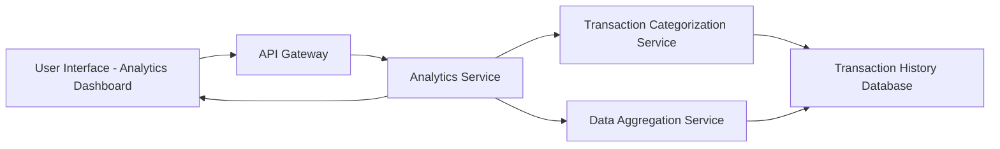

#### 1. High-Level Design

- **Summary:** This epic provides interactive visualizations and analytics to help users understand spending behavior through category-wise analysis and monthly spend trends. Users can explore spending across 9 predefined categories (Food & Dining, Fuel, Shopping, Travel, Entertainment, Utilities, Healthcare, Education, Miscellaneous) and analyze monthly trends over at least 12 months of historical data.

- **Component Flow:**

- **Integration Points:**
  - **Upstream:** Transaction Categorization Service (for automatic category assignment)
  - **Downstream:** Transaction History Database (for trend analysis), Data Aggregation Service (for computing category totals)

- **Key Assumptions:**
  - Transactions are automatically categorized using predefined rules or ML-based classification; historical data for 12 months is readily available in the database.
  - Category totals and trend computations are performed server-side with results cached for performance optimization.

- **NFR Highlights:** Analytics visualizations must render within 3 seconds, support interactive filtering and drill-down capabilities, handle historical data for at least 12 months, and charts must be responsive and accessible.

#### 2. Validation Report

- **Requirements Coverage:** The design comprehensively covers all scope requirements including category-wise spending visualization, monthly spend trend analysis, interactive charts and graphs, spending pattern identification, and category breakdown for all 9 specified categories. NFRs for 3-second rendering time, interactive filtering/drill-down, 12-month historical data support, and responsive/accessible charts are addressed through the analytics service architecture. All dependencies on transaction categorization service, transaction history database, and data aggregation service are incorporated into the component flow.