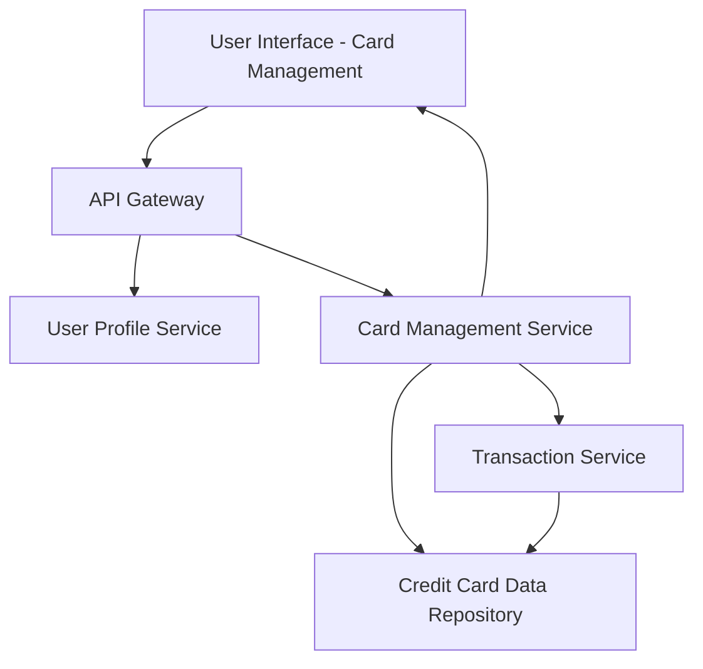

#### 1. High-Level Design

- **Summary:** This epic enables users to manage and monitor multiple credit cards (up to 20) from a single interface. Users can view individual card details, perform card-wise spend analysis, track spending patterns, and monitor card utilization and limits. The feature consolidates all credit card information to help users optimize credit card usage and identify high-utilization cards.

- **Component Flow:**

- **Integration Points:**
  - **Upstream:** User Profile Service (for card ownership validation)
  - **Downstream:** Credit Card Data Repository (for card information), Transaction Service (for card-wise spending data)

- **Key Assumptions:**
  - Card data and transaction records are retrieved via RESTful APIs with response times under 1 second; ownership validation occurs at the service layer.
  - Card utilization metrics are calculated on-demand based on current balance and credit limit data stored in the repository.

- **NFR Highlights:** System must support viewing and managing up to 20 credit cards per user, card data retrieval must complete within 1 second, and interface must be responsive across all device types.

#### 2. Validation Report

- **Requirements Coverage:** The design addresses all scope elements including multiple credit card display, card-wise spend analysis, individual card details view, card utilization tracking, and card selection/filtering. NFRs for supporting up to 20 cards per user, 1-second retrieval time, and responsive interface are incorporated into the service architecture. All dependencies on credit card data repository, transaction service, and user profile service are reflected in the component flow.